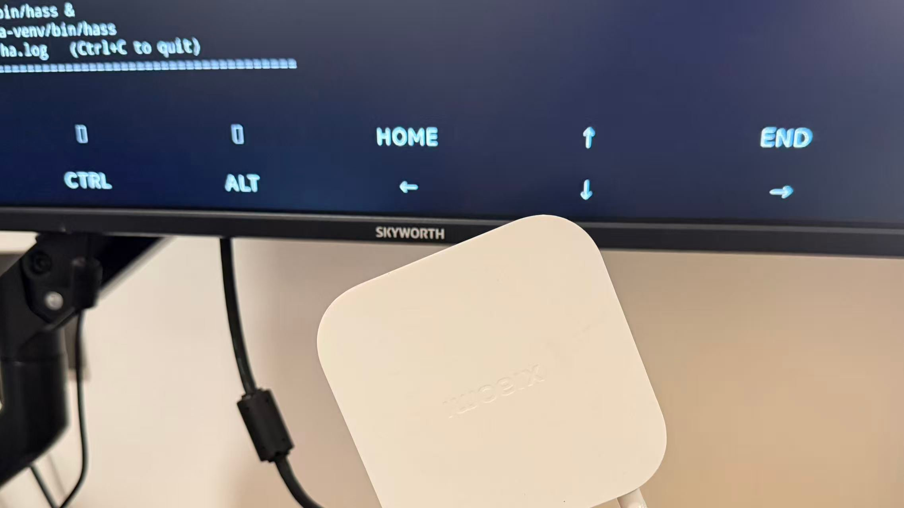
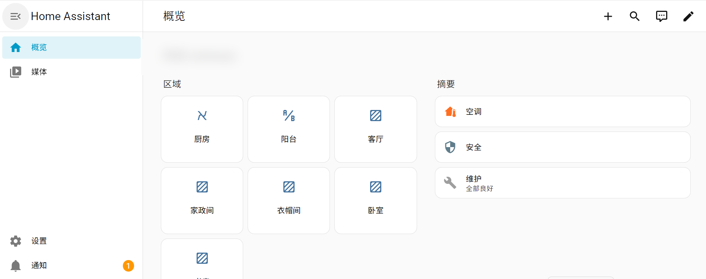
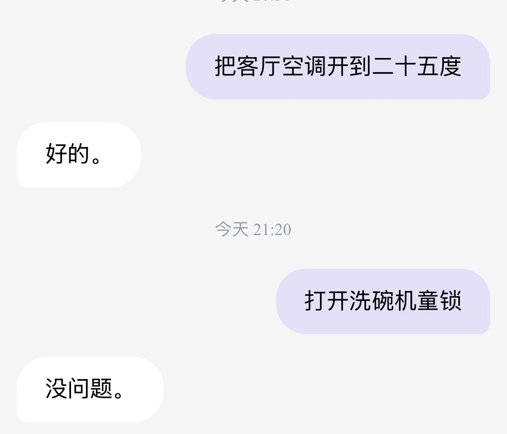
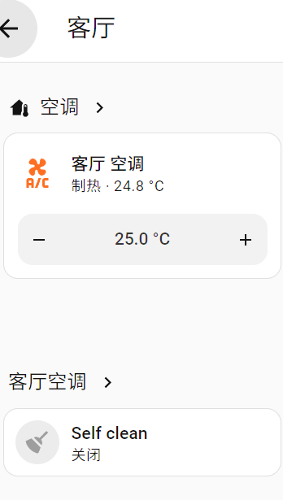
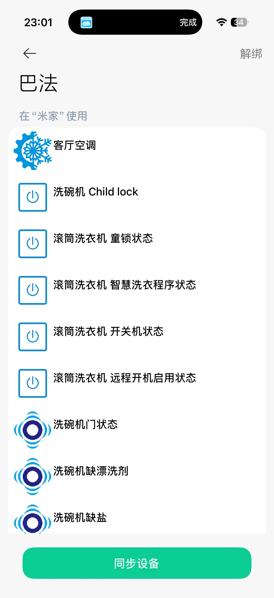
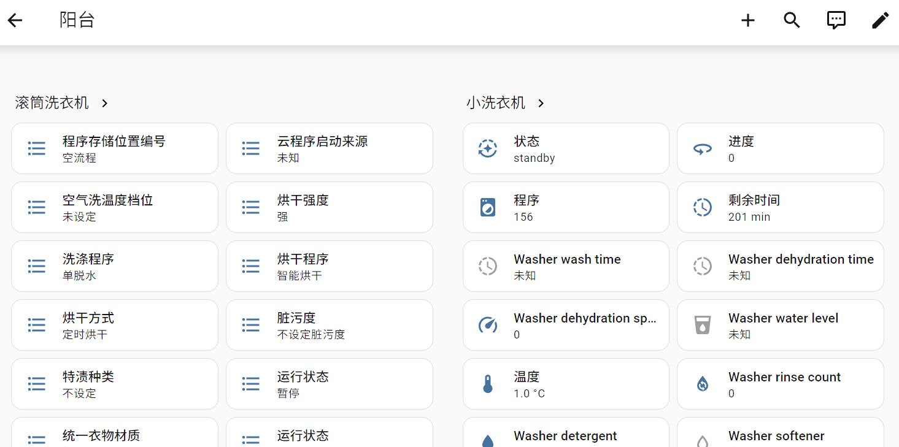

# Home Assistant on an old Android TV box + Xiaoai voice control for Midea/Haier

Turn a **cheap / idle Android TV box** (or an old Android phone) into a **24/7 Home Assistant server**
— **no root, no custom firmware, no Raspberry Pi** — and control **Midea / Haier** appliances
with **Xiaoai** (小爱同学) through a Bemfa Cloud bridge.

> Everything here comes from a real deployment on a **32-bit armv7, 2 GB RAM** Xiaomi TV box (MDZ-26-AA).
> All pitfalls, working versions and compile-free patches are documented. **Not tied to one model** —
> use the hardware checklist to see if your box qualifies.

## Why this repo

- Most guides assume 64-bit + Raspberry Pi; **most idle boxes are 32-bit armv7** with 2 GB RAM.
- 32-bit Android has **no prebuilt wheels** for several HA dependencies (orjson, ulid-transform,
  fnv-hash-fast, uv) and cannot build Rust extensions reliably. This repo ships **pure-Python shims** that work.
- Termux reports `sys.platform == "android"` and its resolver is broken for `pycares` —
  HA refuses to start or cannot resolve DNS. Both fixes are included.
- **Midea/Haier are not supported by Mi Home natively** — the Bemfa Cloud bridge (HA → Bemfa → Mi Home → Xiaoai)
  is the missing link, with tooling to clean up synced devices.

## Features (tested)

| Area | What you get |
|---|---|
| Home Assistant Core | 2026.11.1 in a Termux venv, **no root / no flashing** |
| Midea | LAN-direct via `midea_ac_lan`, including a patch for the D9 washer-dryer combo bug |
| Haier | `haier` integration (Haier Smart Home account) |
| Xiaoai voice | Bemfa Cloud bridge + cleanup tooling |
| Stability | runit supervision (auto-restart), backups, log rotation, package pinning, one-command rollback |
| Remote ops | SSH + adb, plus a WebSocket helper to script HA registry changes |

## Requirements checklist (model-agnostic)

| Item | Target | How to check |
|---|---|---|
| CPU | armv7 (32-bit) or arm64 | `uname -m` |
| RAM | ≥ 2 GB (1 GB is painful) | `free -m` |
| Storage | ≥ 3 GB free | `df -h /data` |
| Android | ≥ 7.0 | `getprop ro.build.version.release` |
| Root | **not required** | — |

## Quick start

```bash
# 1. Install Termux (pick the ABI matching your box) + Termux:Boot
# 2. Follow the tutorial: base packages → venv → dependency shims → install HA → minimal config → start
# 3. Open http://<BOX_IP>:8123 and finish onboarding
```

- 📘 **English step-by-step guide**: [docs/GettingStarted-EN.md](docs/GettingStarted-EN.md)
- 📘 Chinese step-by-step guide: [docs/教程-安卓盒子装HomeAssistant.md](docs/教程-安卓盒子装HomeAssistant.md)

- 🏗 Architecture (English): [docs/Architecture-EN.md](docs/Architecture-EN.md)
- 🏗 Architecture (Chinese): [docs/架构与数据流.md](docs/架构与数据流.md)
- 🧾 Box compatibility list: [docs/盒子型号适配表.md](docs/盒子型号适配表.md)
- 📝 Changelog: [CHANGELOG.md](CHANGELOG.md)
- 🔒 Security policy: [SECURITY.md](SECURITY.md)
- 🤝 Code of Conduct: [CODE_OF_CONDUCT.md](CODE_OF_CONDUCT.md)

## Demo (static screenshot evidence)

No video needed — a timestamp-aligned screenshot chain proves the voice round-trip:

| Step | Content |
|---|---|
| 1 | User: “Xiaoai, turn on the living room AC” |
| 2 | Xiaoai: “OK, living room AC is on” |
| 3 | HA `climate.ke_ting`: `off` → `cool 26°C` |

| Box (old Xiaomi TV box) | HA dashboard (7 areas) |
|---|---|
|  |  |

| Real Xiaoai conversation (21:20, executed) | HA AC state synced (25.0°C) |
|---|---|
|  |  |

| Bemfa devices visible in Mi Home | Yangtai: washer + mini washer |
|---|---|
|  |  |

More screenshots live in `docs/images/` (`07-xiaoai-history`, `08-dishwasher`).

## Scripts

See [scripts/README.md](scripts/README.md): 32-bit shims, Android platform patch, DNS fix,
Midea D9 patch, HA start script, runit setup, backup / self-test / rollback, Bemfa cleanup, HA WebSocket helper.

## Need help?

- 📖 The tutorial's troubleshooting chapter + "12 beginner pitfalls" cover ~90% of problems;
- 🐞 Otherwise open an issue with: box model / architecture / Android version / HA version / full error;
- 🤖 Or ask an AI assistant step by step (DeepSeek / ChatGPT / Claude / **DSH – DeepSeek Harness**) —
  prompt template is in the tutorial's "Where to ask for help" section;
- ⚠️ Never share accounts, passwords, tokens, IPs or MACs with anyone (including AI).

## Disclaimer

Personal experience sharing, **unofficial**; not affiliated with Xiaomi / Midea / Haier / Home Assistant.
Modifying system apps and configs carries risk — back up first. All IPs/MACs/accounts in this repo
are placeholders or sanitized. Third-party APIs may change at any time.

## Credits

Home Assistant Core, Termux, `midea_ac_lan`, `haier` (HACS), `bemfa_cloud`, `xiaomi_miot`.\n\nBuilt and debugged with the help of **DSH (DeepSeek Harness)** as an AI coding agent.
Each project keeps its own license.

## License

MIT
