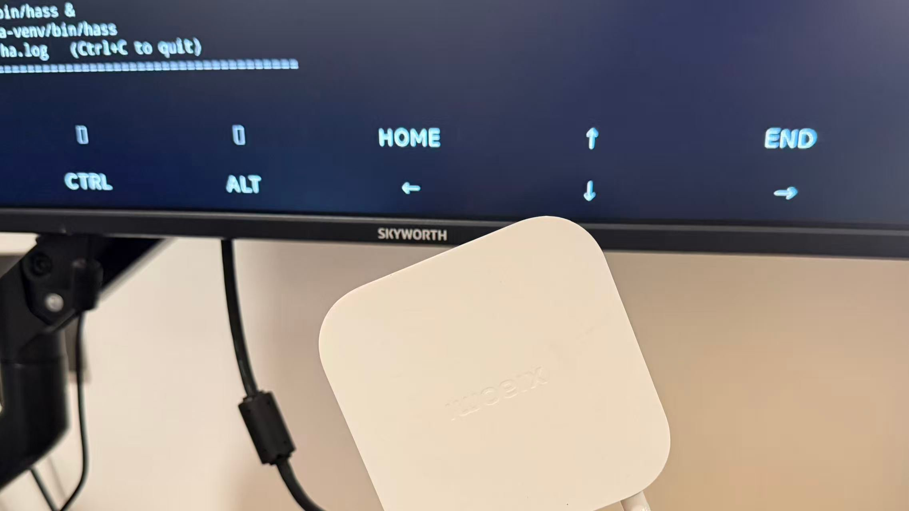
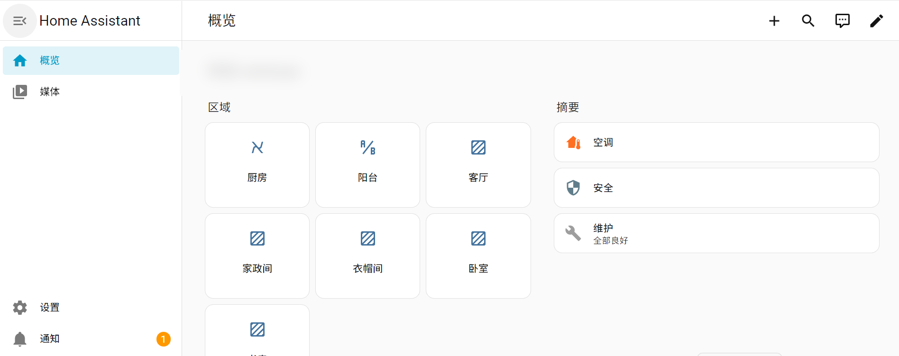
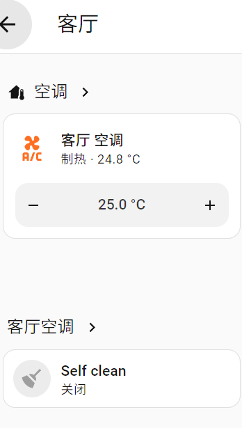
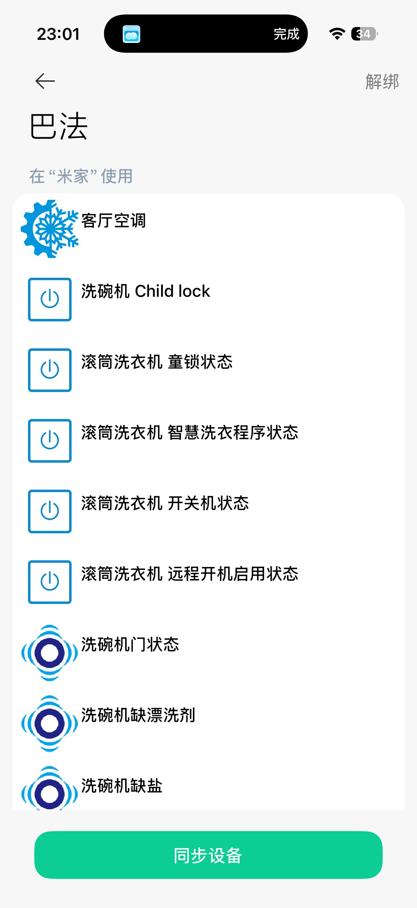

# 旧安卓电视盒子跑 Home Assistant + 小爱语音控制美的/海尔（免刷机、免 root）
[](https://github.com/VotaverUno/android-tv-box-home-assistant/actions/workflows/markdown-link-check.yml)

把闲置的 **安卓电视盒子**（小米盒子 / 运营商盒子 / 各种 Android TV Box）
变成一个 7×24 小时的 Home Assistant 服务器，并通过 **巴法云 → 米家 → 小爱同学**
实现语音控制 **美的 / 海尔** 等米家接不进来的家电。

> 本仓库内容来自一台 **32 位 armv7、2GB 内存、eMMC 存储** 的老小米盒子（MDZ-26-AA）的**实战记录**：
> 踩过的坑、能用的版本、绕开编译的补丁，都写在文档里。**不绑定具体型号**，按自检清单判断你的盒子能不能用。

## 适合谁

- 有闲置安卓盒子，想跑 Home Assistant 但不想买树莓派/NAS
- 想用 **小爱同学语音控制非米家设备**（美的空调/洗碗机/热水器、海尔洗衣机等）
- 盒子是 **32 位（armv7）**、内存不大、还不能 root 的"困难模式"

## 能做什么（实测跑通的）

| 能力 | 说明 |
|---|---|
| Home Assistant Core | 2026.11.1，跑在 Termux + venv 里，**免刷机、免 root** |
| 美的设备 | 局域网直连（midea_ac_lan），含 32 位兼容补丁与 D9 复式洗烘一体机 bug 修复 |
| 海尔设备 | haier 集成（海尔智家账号） |
| 小爱语音 | 巴法云桥接：HA → 巴法云 → 米家"其他平台设备" → 小爱同学 |
| 稳定性 | runit 守护（崩溃自动拉起）、自动备份、日志轮转、版本锁定、一键回滚 |
| 远程维护 | SSH / adb 双通道，小白也能敲命令观测 |

## 文档

- 📘 **[教程：安卓盒子从零安装 Home Assistant（小白版）](docs/教程-安卓盒子装HomeAssistant.md)** ← 从这里开始
- 🧰 `scripts/`：可直接复用的脚本（32 位垫片、DNS 补丁、平台补丁、备份/自检/回滚、美的 D9 补丁、巴法云工具）
- 🩺 故障排查表：教程最后一章（16+ 条真实踩坑）
- 🌍 English README: [README.en.md](README.en.md)
- 📘 English getting-started guide: [docs/GettingStarted-EN.md](docs/GettingStarted-EN.md)
- 🏗 架构与数据流（角色分工 / 我们改了哪些程序 / 看门狗设计）: [docs/架构与数据流.md](docs/架构与数据流.md)
- 📣 发布文案模板（B 站/小红书/酷安/Reddit/HN）: [docs/发布文案模板.md](docs/发布文案模板.md)
- 🏗 English architecture: [docs/Architecture-EN.md](docs/Architecture-EN.md)
- 🔒 安全策略: [SECURITY.md](SECURITY.md)
- 🤝 行为准则: [CODE_OF_CONDUCT.md](CODE_OF_CONDUCT.md)

## 快速开始（3 步）

```bash
# 1. 在盒子上安装 Termux（选对应 ABI：arm64-v8a 或 armeabi-v7a）+ Termux:Boot
# 2. 按教程依次执行：基础环境 → venv → 依赖垫片 → 安装 HA → 最小配置 → 启动
# 3. 浏览器打开 http://<盒子IP>:8123 完成初始化
```

完整步骤、每一步的验收命令、以及"卡住了怎么办"，见教程。

## 演示（静态截图证据）

> 不拍视频也能证明"小爱真的能控制美的空调"：用**时间戳对齐的截图链**即可。

**对白（实际测试）**

| 步骤 | 内容 |
|---|---|
| 1 | 用户对小爱说：「**小爱同学，打开客厅空调**」 |
| 2 | 小爱回复：「好的，已为你打开客厅空调」 |
| 3 | HA 中 `climate.ke_ting` 状态由 `关` 变为 `制冷 26℃` |

**实拍证据**

| 老盒子实拍（接入电视） | HA 概览（7 个区域） |
|---|---|
|  |  |

| 小爱真实对话（21:20 执行成功） | HA 里空调同步变化（25.0°C） |
|---|---|
|  |  |

| 巴法云设备（米家可见） | 阳台：滚筒洗衣机 + 小洗衣机 |
|---|---|
|  |  |

**截图清单**（放在 `docs/images/`，按文件名引用）：

| 文件名 | 拍什么 | 作用 |
|---|---|---|
| `01-box.jpg` | 🎁 盒子实物（接电视/投影） | 证明"真的是老盒子" |
| `02-ha-dashboard.png` | HA 概览页（含空调/洗碗机/洗衣机卡片） | 证明 HA 跑起来了 |
| `03-xiaoai-command.png` | 米家 App → 小爱音箱 → **对话记录**里"打开客厅空调" | 证明语音指令被识别执行 |
| `04-ha-state-change.png` | HA 里空调实体"上次变化"时间 | 与 03 时间相近 |
| `05-bemfa-console.jpg` | 巴法云设备列表（可选） | 证明桥接链路 |

## 硬件自检（不绑定型号）

| 检查项 | 要求 | 命令/方法 |
|---|---|---|
| CPU 架构 | 32 位(armv7) 或 64 位(arm64) 都可 | Termux 里 `uname -m` / `getprop ro.product.cpu.abi` |
| 内存 | ≥ 2GB（1GB 会很吃力） | `free -m` |
| 存储 | 空闲 ≥ 3GB（HA + venv 约 1.5~2GB） | `df -h /data` |
| Android | ≥ 7.0（API 24+） | `getprop ro.build.version.release` |
| root | **不需要** | — |
| 电视应用 | 建议禁用省内存（可恢复） | `pm disable-user --user 0 <包名>` |

## 需要帮助？

- 📖 90% 的问题教程第 10 章「故障排查」+ 第 13 章「新手最容易卡住的 12 个点」里都有；
- 🐞 还是不行？用 [Bug 模板](.github/ISSUE_TEMPLATE/bug_report.yml) 提 Issue，并附：盒子型号 / 架构 / Android / HA 版本 / 完整报错；
- 🤖 也可以让 AI 助手逐条带你执行（DeepSeek / ChatGPT / Claude / **DSH（DeepSeek Harness）** 均可），
  提示词模板见教程第 14 章「卡住了怎么求助」；
- ⚠️ 任何时候都**不要**把账号、密码、token、IP、MAC 发给任何人或 AI。

## 反馈与贡献

- 🐞 遇到问题：用 [Bug 报告模板](.github/ISSUE_TEMPLATE/bug_report.yml) 提交（请先看教程的故障排查章节，并删除日志里的 IP/账号/token）；
- 💡 功能建议：用 [Feature 模板](.github/ISSUE_TEMPLATE/feature_request.yml)；
- 🛠 想贡献代码/文档：见 [CONTRIBUTING.md](CONTRIBUTING.md)；
- ⭐ 如果这个项目帮到了你，点个 Star 就是最大的支持。

## 免责声明

- 本项目为个人经验分享，**非官方**，与小米/美的/海尔/Home Assistant 官方无关；
- 刷机/禁用系统应用/修改系统配置有风险，**操作前请自行备份**；
- 文档中的 IP、MAC、账号、设备编号均为占位或已脱敏，请替换成你自己的；
- 美的/巴法云等第三方接口可能随官方更新失效，请以官方文档为准。

## License

MIT
