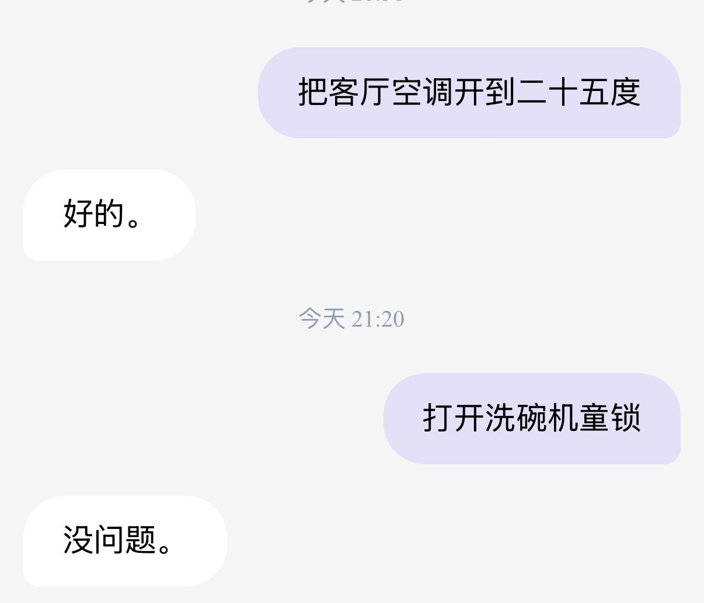
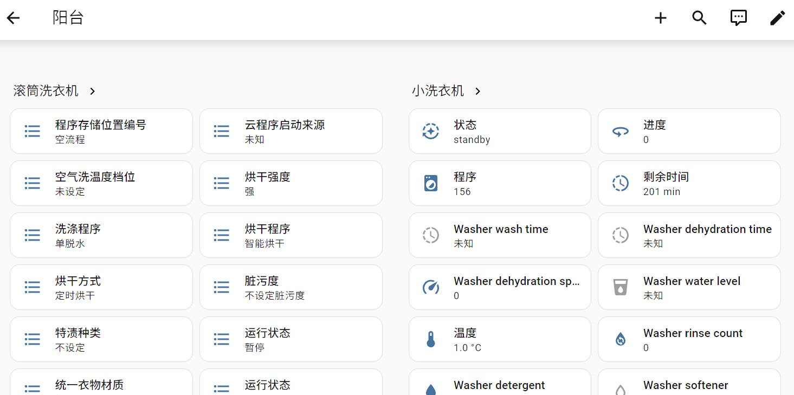
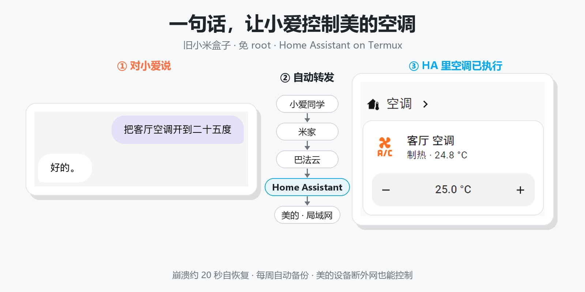
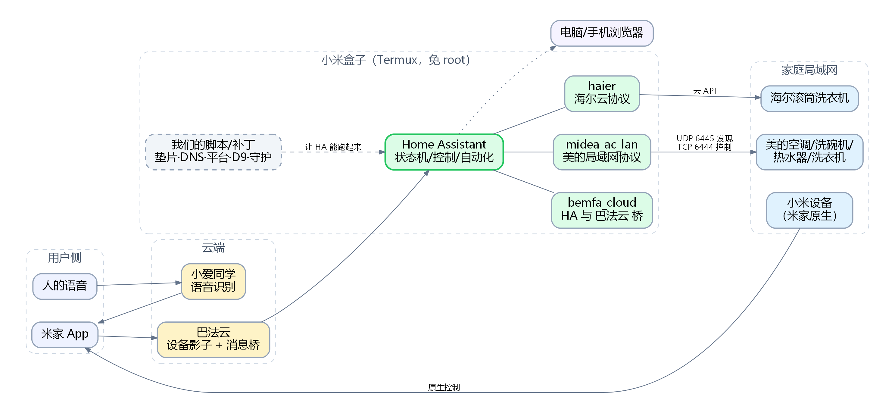

# Home Assistant on an old Android TV box + Xiaoai voice control for Midea/Haier

[](https://github.com/VotaverUno/android-tv-box-home-assistant/actions/workflows/markdown-link-check.yml)

> **English** · **[中文](#zh)**

Turn a **cheap / idle Android TV box** (or an old Android phone) into a **24/7 Home Assistant server**
— **no root, no custom firmware, no Raspberry Pi** — and control **Midea / Haier** appliances
with **Xiaoai** (小爱同学) through a Bemfa Cloud bridge.

> Everything here comes from a real deployment on a **32-bit armv7, 2 GB RAM** Xiaomi TV box (MDZ-26-AA).
> All pitfalls, working versions and compile-free patches are documented. **Not tied to one model** —
> use the hardware checklist to see if your box qualifies.

> Troubleshooting: [docs/Troubleshooting-EN.md](docs/Troubleshooting-EN.md)

## Why this repo

- Most guides assume 64-bit + Raspberry Pi; **most idle boxes are 32-bit armv7** with 2 GB RAM.
- 32-bit Android has **no prebuilt wheels** for several HA dependencies (orjson, ulid-transform,
  fnv-hash-fast, uv) and cannot build Rust extensions reliably. This repo ships **pure-Python shims** that work.
- Termux reports `sys.platform == "android"` and its resolver is broken for `pycares` —
  HA refuses to start or cannot resolve DNS. Both fixes are included.
- **Midea/Haier are not supported by Mi Home natively** — the Bemfa Cloud bridge (HA → Bemfa → Mi Home → Xiaoai)
  is the missing link, with tooling to clean up synced devices.

## Features (tested)

| Area | What you get |
|---|---|
| Home Assistant Core | 2026.11.1 in a Termux venv, **no root / no flashing** |
| Midea | LAN-direct via `midea_ac_lan`, including a patch for the D9 washer-dryer combo bug |
| Haier | `haier` integration (Haier Smart Home account) |
| Xiaoai voice | Bemfa Cloud bridge + cleanup tooling |
| Stability | runit supervision, **watchdog** (health probe / memory / disk + cooldown), **weekly auto-backup + monthly restore drill**, log rotation, package pinning, **17-check self-test**, one-command rollback, alerts (WeChat / HA notifications) |
| Remote ops | SSH + adb, plus a WebSocket helper to script HA registry changes |

## Requirements checklist (model-agnostic)

| Item | Target | How to check |
|---|---|---|
| CPU | armv7 (32-bit) or arm64 | `uname -m` |
| RAM | ≥ 2 GB (1 GB is painful) | `free -m` |
| Storage | ≥ 3 GB free | `df -h /data` |
| Android | ≥ 7.0 | `getprop ro.build.version.release` |
| Root | **not required** | — |

## Quick start

```bash
# 1. Install Termux (pick the ABI matching your box) + Termux:Boot
# 2. Follow the tutorial: base packages → venv → dependency shims → install HA → minimal config → start
# 3. Open http://<BOX_IP>:8123 and finish onboarding
```

- 📘 **English step-by-step guide**: [docs/GettingStarted-EN.md](docs/GettingStarted-EN.md)
- 📘 Chinese step-by-step guide: [docs/教程-安卓盒子装HomeAssistant.md](docs/教程-安卓盒子装HomeAssistant.md)

- 🏗 Architecture (English): [docs/Architecture-EN.md](docs/Architecture-EN.md)
- 🧱 Tech stack (layers + rationale, Chinese): [docs/技术栈.md](docs/技术栈.md)
- 🏗 Architecture (Chinese): [docs/架构与数据流.md](docs/架构与数据流.md)
- 🚑 Upgrade & recovery runbook (Chinese): [docs/升级与恢复Runbook.md](docs/升级与恢复Runbook.md)
- 🧾 Box compatibility list: [docs/盒子型号适配表.md](docs/盒子型号适配表.md)
- 📝 Changelog: [CHANGELOG.md](CHANGELOG.md)
- 🔒 Security policy: [SECURITY.md](SECURITY.md)
- 🤝 Code of Conduct: [CODE_OF_CONDUCT.md](CODE_OF_CONDUCT.md)

## Demo (static screenshot evidence)

No video needed — a timestamp-aligned screenshot chain proves the voice round-trip:

| Step | Content |
|---|---|
| 1 | User: “Xiaoai, turn on the living room AC” |
| 2 | Xiaoai: “OK, living room AC is on” |
| 3 | HA `climate.ke_ting`: `off` → `cool 26°C` |

| Box (old Xiaomi TV box) | HA dashboard (7 areas) |
|---|---|
|  |  |

| Real Xiaoai conversation (21:20, executed) | HA AC state synced (25.0°C) |
|---|---|
|  |  |

| Bemfa devices visible in Mi Home | Yangtai: washer + mini washer |
|---|---|
|  |  |

More screenshots live in `docs/images/` (`07-xiaoai-history`, `08-dishwasher`).

## Scripts

See [scripts/README.md](scripts/README.md): 32-bit shims, Android platform patch, DNS fix,
Midea D9 patch, HA start script, runit setup, backup / self-test / rollback, Bemfa cleanup, HA WebSocket helper.

## Need help?

- 📖 The tutorial's troubleshooting chapter + "12 beginner pitfalls" cover ~90% of problems;
- 🐞 Otherwise open an issue with: box model / architecture / Android version / HA version / full error;
- 🤖 Or ask an AI assistant step by step (DeepSeek / ChatGPT / Claude / **DSH – DeepSeek Harness**) —
  prompt template is in the tutorial's "Where to ask for help" section;
- ⚠️ Never share accounts, passwords, tokens, IPs or MACs with anyone (including AI).

## Disclaimer

Personal experience sharing, **unofficial**; not affiliated with Xiaomi / Midea / Haier / Home Assistant.
Modifying system apps and configs carries risk — back up first. All IPs/MACs/accounts in this repo
are placeholders or sanitized. Third-party APIs may change at any time.

## Credits

Home Assistant Core, Termux, `midea_ac_lan`, `haier` (HACS), `bemfa_cloud`, `xiaomi_miot`.\n\nBuilt and debugged with the help of **DSH (DeepSeek Harness)** as an AI coding agent.
Each project keeps its own license.

## License

MIT

---

<a name="zh"></a>

# 旧安卓电视盒子跑 Home Assistant + 小爱语音控制美的/海尔（免刷机、免 root）


把闲置的 **安卓电视盒子**（小米盒子 / 运营商盒子 / 各种 Android TV Box）
变成一个 7×24 小时的 Home Assistant 服务器，并通过 **巴法云 → 米家 → 小爱同学**
实现语音控制 **美的 / 海尔** 等米家接不进来的家电。

> 本仓库内容来自一台 **32 位 armv7、2GB 内存、eMMC 存储** 的老小米盒子（MDZ-26-AA）的**实战记录**：
> 踩过的坑、能用的版本、绕开编译的补丁，都写在文档里。**不绑定具体型号**，按自检清单判断你的盒子能不能用。

## 适合谁

- 有闲置安卓盒子，想跑 Home Assistant 但不想买树莓派/NAS
- 想用 **小爱同学语音控制非米家设备**（美的空调/洗碗机/热水器、海尔洗衣机等）
- 盒子是 **32 位（armv7）**、内存不大、还不能 root 的"困难模式"

## 能做什么（实测跑通的）

| 能力 | 说明 |
|---|---|
| Home Assistant Core | 2026.11.1，跑在 Termux + venv 里，**免刷机、免 root** |
| 美的设备 | 局域网直连（midea_ac_lan），含 32 位兼容补丁与 D9 复式洗烘一体机 bug 修复 |
| 海尔设备 | haier 集成（海尔智家账号） |
| 小爱语音 | 巴法云桥接：HA → 巴法云 → 米家"其他平台设备" → 小爱同学 |
| 家电程序控制 | **一键脚本**：海尔智慧洗 / 洗碗机 Standard / 小洗衣机双筒程序（156/148，按自己 App 实测）；功能开关（开关机、抖散、新风、童锁等）全部保留 |
| 稳定性 | runit 守护、**看门狗**（健康探测/内存/磁盘 + 冷却）、**每周自动备份 + 每月恢复演练**、日志轮转、版本锁定、**17 项自检**、一键回滚、异常推送（微信 / HA 通知） |
| 远程维护 | SSH / adb 双通道，小白也能敲命令观测 |

## 文档

- 📘 **[教程：安卓盒子从零安装 Home Assistant（小白版）](docs/教程-安卓盒子装HomeAssistant.md)** ← 从这里开始
- 🧰 `scripts/`：可直接复用的脚本（32 位垫片、DNS 补丁、平台补丁、**看门狗**、备份/自检/回滚、美的 D9 补丁、巴法云工具、通知助手）
- 🩺 故障排查表：教程最后一章（16+ 条真实踩坑）
- 🌍 English README: [README.en.md](README.en.md)
- 📘 English getting-started guide: [docs/GettingStarted-EN.md](docs/GettingStarted-EN.md)
- 🏗 架构与数据流（角色分工 / 我们改了哪些程序 / 看门狗设计）: [docs/架构与数据流.md](docs/架构与数据流.md)
- 🏗 English architecture: [docs/Architecture-EN.md](docs/Architecture-EN.md)
- 🧱 技术栈（分层清单 + 选型理由）: [docs/技术栈.md](docs/技术栈.md)
- 🧺 **家电控制与语音排错（洗衣机/洗碗机/小爱）**: [docs/家电控制与语音排错.md](docs/家电控制与语音排错.md)
- 🔒 安全策略: [SECURITY.md](SECURITY.md)
- 🤝 行为准则: [CODE_OF_CONDUCT.md](CODE_OF_CONDUCT.md)

## 快速开始（3 步）

```bash
# 1. 在盒子上安装 Termux（选对应 ABI：arm64-v8a 或 armeabi-v7a）+ Termux:Boot
# 2. 按教程依次执行：基础环境 → venv → 依赖垫片 → 安装 HA → 最小配置 → 启动
# 3. 浏览器打开 http://<盒子IP>:8123 完成初始化
```

完整步骤、每一步的验收命令、以及"卡住了怎么办"，见教程。


## 演示（静态截图证据）

**对白（实际测试）**

| 步骤 | 内容 |
|---|---|
| 1 | 用户对小爱说：「**小爱同学，打开客厅空调**」 |
| 2 | 小爱回复：「好的，已为你打开客厅空调」 |
| 3 | HA 中 `climate.ke_ting` 状态由 `关` 变为 `制冷 26℃` |

**实拍证据**

| 老盒子实拍（接入显示器） | HA 概览（7 个区域） |
|---|---|
|  |  |

| 一句话控制链路（小爱 → 米家 → 巴法云 → HA → 空调） | 整体架构 |
|---|---|
|  |  |

| 小爱真实对话（21:20 执行成功） | HA 里空调同步变化（25.0°C） |
|---|---|
|  |  |

| 巴法云设备（米家可见） | 阳台：滚筒洗衣机 + 小洗衣机 |
|---|---|
|  |  |

**截图清单**（放在 `docs/images/`，按文件名引用）：

| 文件名 | 拍什么 | 作用 |
|---|---|---|
| `01-box.jpg` | 🎁 盒子实物（接入显示器） | 证明"真的是老盒子" |
| `02-ha-dashboard.png` | HA 概览页（含空调/洗碗机/洗衣机卡片） | 证明 HA 跑起来了 |
| `03-xiaoai-command.png` | 米家 App → 小爱音箱 → **对话记录**里"打开客厅空调" | 证明语音指令被识别执行 |

## 硬件自检（不绑定型号）

| 检查项 | 要求 | 命令/方法 |
|---|---|---|
| CPU 架构 | 32 位(armv7) 或 64 位(arm64) 都可 | Termux 里 `uname -m` / `getprop ro.product.cpu.abi` |
| 内存 | ≥ 2GB（1GB 会很吃力） | `free -m` |
| 存储 | 空闲 ≥ 3GB（HA + venv 约 1.5~2GB） | `df -h /data` |
| Android | ≥ 7.0（API 24+） | `getprop ro.build.version.release` |
| root | **不需要** | — |
| 电视应用 | 建议禁用省内存（可恢复） | `pm disable-user --user 0 <包名>` |

## 需要帮助？

- 📖 90% 的问题教程第 10 章「故障排查」+ 第 13 章「新手最容易卡住的 12 个点」里都有；
- 🐞 还是不行？用 [Bug 模板](.github/ISSUE_TEMPLATE/bug_report.yml) 提 Issue，并附：盒子型号 / 架构 / Android / HA 版本 / 完整报错；
- 🤖 也可以让 AI 助手逐条带你执行（DeepSeek / ChatGPT / Claude / **DSH（DeepSeek Harness）** 均可），
  提示词模板见教程第 14 章「卡住了怎么求助」；
- ⚠️ 任何时候都**不要**把账号、密码、token、IP、MAC 发给任何人或 AI。

## 反馈与贡献

- 🐞 遇到问题：用 [Bug 报告模板](.github/ISSUE_TEMPLATE/bug_report.yml) 提交（请先看教程的故障排查章节，并删除日志里的 IP/账号/token）；
- 💡 功能建议：用 [Feature 模板](.github/ISSUE_TEMPLATE/feature_request.yml)；
- 🛠 想贡献代码/文档：见 [CONTRIBUTING.md](CONTRIBUTING.md)；
- ⭐ 如果这个项目帮到了你，点个 Star 就是最大的支持。

## 免责声明

- 本项目为个人经验分享，**非官方**，与小米/美的/海尔/Home Assistant 官方无关；
- 刷机/禁用系统应用/修改系统配置有风险，**操作前请自行备份**；
- 文档中的 IP、MAC、账号、设备编号均为占位或已脱敏，请替换成你自己的；
- 美的/巴法云等第三方接口可能随官方更新失效，请以官方文档为准。

## License

MIT
