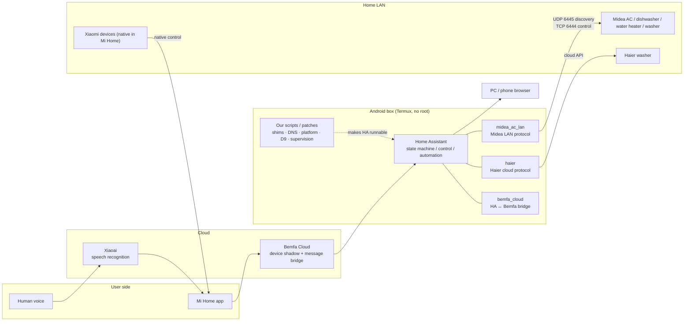
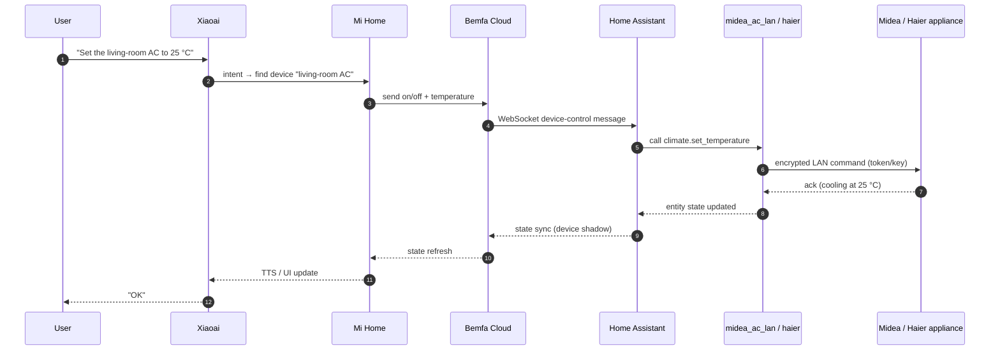
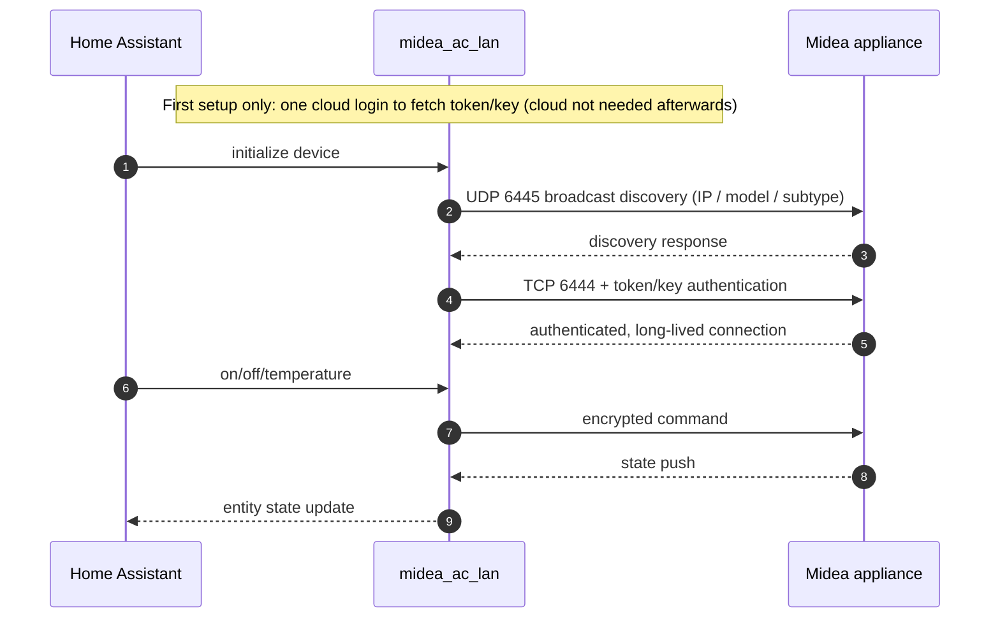
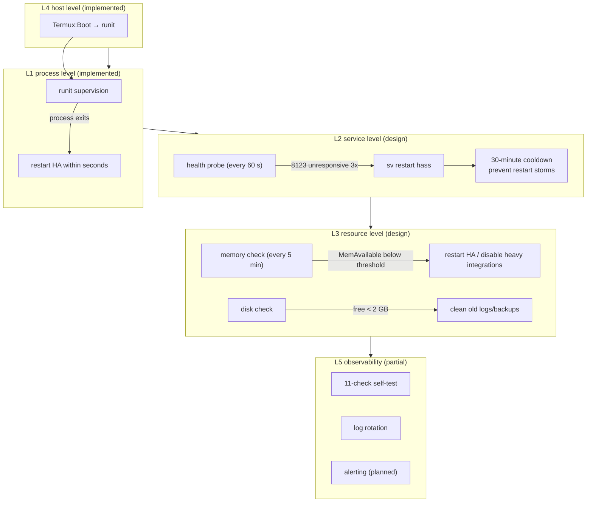
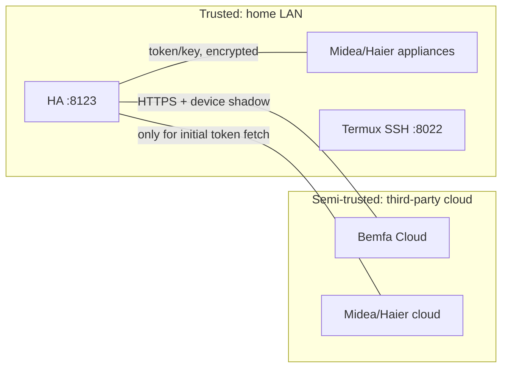

# Architecture, Roles & Design (English)

> Read this before installing. It explains the role of each component — Xiaoai, Mi Home,
> Bemfa Cloud, Home Assistant, the Android box, integrations and our scripts — what we patched
> and why, and how the watchdog (self-healing) layers are designed.

---

## 1. Roles at a glance

| Role | What it is | Responsible for | NOT responsible for |
|---|---|---|---|
| **Xiaoai (小爱同学)** | Voice entry point | listening, intent recognition, TTS | storing device state, talking to Midea directly |
| **Mi Home app** | Device catalog + voice routing | device list, room assignment, forwarding commands | executing control logic |
| **Bemfa Cloud** | Cloud bridge (MQTT/WS) | bidirectional device-shadow sync between HA and Mi Home | automation, business logic; **device names have a length limit** |
| **Home Assistant** | Control hub | state machine, control, automation, bridging, self-healing | speech recognition |
| **Android box** | Runtime host | runs Termux + Linux processes (HA/scripts) | business logic; **2 GB / 32-bit / eMMC are the real constraints** |
| **Integrations** (`midea_ac_lan`, `haier`, `bemfa_cloud`, `xiaomi_miot`) | Protocol translation | translate HA calls into device protocols | guarantee support for every model |
| **Our scripts / patches** | Compatibility layer | make unsupported platforms/devices work | modifying firmware, bypassing paid features |

> Main path: **voice → Mi Home → Bemfa Cloud → Home Assistant → integration → appliance**,
> with state flowing back the same way.

---

## 2. Overall architecture

---

## 3. A voice command, step by step

> Key point: **Xiaoai never talks to Midea directly.** It only knows devices in Mi Home. Midea/Haier
> appliances do not exist in Mi Home, so Bemfa Cloud makes them look like third-party devices —
> which is why HA must stay online and keep its Bemfa connection alive.

---

## 4. Midea appliances: direct LAN control (no cloud)

> Why one cloud login is enough: **day-to-day control goes over the LAN** and works without
> internet. Only the initial token fetch (and a few cloud features) needs the cloud.
> This is also how Midea cloud risk control is avoided.

---

## 5. What we patched (and why)

| # | Patch | Why it is required | Location | Effect |
|---|---|---|---|---|
| 1 | **Allow Android platform** | HA only accepts Linux/macOS/WSL and calls `sys.exit(1)` on `android` | `patch-android-platform.py` | HA starts |
| 2 | **Android DNS fix** | `pycares.getaddrinfo()` is unimplemented on Android while HA's HTTP client uses it → every outbound request fails with `Could not contact DNS servers` | `sitecustomize.py` | cloud logins and integrations work |
| 3 | **32-bit pure-Python shims** | no armv7 wheels for orjson/ulid/fnv/uv; building Rust on-device is unreliable | `shims-32bit.py` | install succeeds; startup drops from minutes to 13–40 s |
| 4 | **Minimal config** | `default_config` pulls Bluetooth/voice/media; `recorder` is very slow on eMMC | `configuration.yaml` template | startup 40–90 s, memory under control |
| 5 | **Midea D9 patch** | upstream integration misses the `default` flag for the D9 washer-dryer combo → device polls but creates 0 entities | `patch-midea-d9-default.py` | 30 entities created |
| 6 | **mobile_app without cloud dependency** | `mobile_app` after_dependencies include `cloud` → needs openai → jiter/pydantic require Rust → install fails → companion app cannot connect | manifest patch | iPhone/Android app connects |
| 7 | **Bemfa name-length adaptation** | Bemfa DB column for device names is limited (`v_name too long`) | short entity names + `bemfa-cleanup.py` | sync succeeds, no stale devices in Mi Home |
| 8 | **runit supervision** | a bare `nohup` process is never restarted | `stability/runit-setup.sh` | restarted within seconds after `kill -9` |
| 9 | **Log rotation / backup / self-test / rollback** | eMMC wear and no config backup | `stability/*` | recoverable and observable |
| 10 | **Host tuning** | 2 GB RAM consumed by TV apps and Xiaomi cloud polling | `pm disable-user` TV apps; disable `xiaomi_miot` | startup 361 s → 38.8 s |
| 11 | **HA WebSocket automation channel** | many actions are UI-only, hard to script for debugging | `ha-ws-probe.py` | scripted rename/area/reload |
| 12 | **Version pinning** | one `pkg upgrade` can upgrade Python and break the venv | `apt-mark hold python python-pip` | no surprise breakage |

> Principle: change **the minimum needed to make the program run**; never modify device firmware,
> never bypass paid features, never violate third-party terms.

---

## 6. Watchdog (self-healing) design

### 6.1 Layered design

### 6.2 Why layers

| Layer | Saves you from | Cannot save you from |
|---|---|---|
| L1 runit | crash / OOM kill | process alive but service hung |
| L2 health probe | hang (port unresponsive) | slow memory leak |
| L3 resource watchdog | memory/disk exhaustion | hardware failure |
| L4 boot autostart | power loss / reboot | runtime crash (handled by L1) |
| L5 self-test/alert | early human detection | automatic repair |

**Core idea**: each layer handles one class of failure. Auto-restarts in L2/L3 must include a
**30-minute cooldown** and must not judge while HA is starting — otherwise the watchdog itself
becomes the outage (restart storm).

### 6.3 Implementation status

| Mechanism | Status |
|---|---|
| runit process supervision | ✅ implemented and tested (`kill -9` → web UI back in ~20 s) |
| Termux:Boot autostart | ✅ implemented (simulated; real power-cycle test pending) |
| Log rotation (logrotate + daily runit job) | ✅ implemented |
| Backups (script, keep 4) | ✅ implemented; scheduled job pending |
| 11-check self-test / one-command rollback | ✅ implemented |
| 8123 health probe + auto restart (with cooldown) | 🧩 designed, not implemented |
| Memory/disk threshold watchdog | 🧩 designed, not implemented |
| Alerting (Bemfa / HA app) | 🧩 planned |

---

## 7. Trust boundaries

- Never expose 8123 / SSH to the public internet; use a VPN (WireGuard/Tailscale) for remote access;
- Midea/Haier credentials are used **only** for the initial token fetch; daily control is LAN-only;
- Treat the Bemfa UID as a secret — never commit it or post screenshots of it;
- Device token/key live in `.storage` — keep them inside backups.

---

## 8. Data-flow summary

| Node | Input | Output | Failure symptom |
|---|---|---|---|
| Xiaoai | speech | intent | "I don't understand" / "no such device" |
| Mi Home | intent | platform command | empty device list (Bemfa not bound) |
| Bemfa Cloud | platform command | device-shadow message | Mi Home devices offline, HA state not updating |
| HA | shadow message | integration call | :8123 unreachable, entities unavailable |
| Integration | HA call | device protocol | cloud login failed / token invalid |
| Appliance | protocol command | physical action + ack | appliance ignores command / LAN unreachable |
