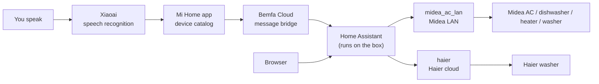

# Getting Started: Home Assistant on an Android TV box (beginner friendly)

> Works with **any** Android TV box / old Android phone that can run Termux — **no root, no custom firmware**.
> Goal: turn the box into a 24/7 Home Assistant server and control **Midea / Haier** appliances with
> **Xiaoai** voice commands.
>
> How to read: follow top to bottom. Every step has a **verify** command — do not continue until it passes.

---

## Before you start: plug in a USB mouse + keyboard

Using a TV remote to type Terminal commands is painful. In practice:

- **Mouse**: on the TV box you usually need to **double-click to select**; a single click only moves the cursor.
- **Keyboard**: a USB keyboard (or Bluetooth keyboard) works normally — **Enter = confirm**, and you can type commands directly.
- A USB hub helps if you have only one port. As a fallback you can also type remotely via `adb shell` from a PC.

**About the display**: a monitor or TV via HDMI works fine, but **no display is needed for daily operation** — after setup, the box runs Home Assistant in the background; manage it from any browser at `http://BOX_IP:8123`. Connect a display + mouse/keyboard only for first-time installation and troubleshooting.


## 0.0 Architecture at a glance (5 min, recommended)

Main path: **voice → Mi Home → Bemfa Cloud → Home Assistant → integration → appliance**



| Role | Does | Does NOT |
|---|---|---|
| Xiaoai | speech recognition, intent, TTS | store device state, talk to Midea directly |
| Mi Home | device list, rooms, voice routing | execute control logic |
| Bemfa Cloud | HA ↔ Mi Home device shadow bridge | automation; **device name length is limited** |
| Home Assistant | state machine, control, automation, bridge | speech recognition |
| Android box | runs Termux + HA process | 2 GB / 32-bit / eMMC are the real constraints |
| Integrations | protocol translation (Midea/Haier/Bemfa) | guarantee every model works |
| Our scripts | shims / patches / supervision | modify firmware, bypass paid features |

> Full version (sequence diagrams, **what we patched**, **watchdog design**):
> English: [Architecture-EN.md](Architecture-EN.md) ｜ 中文: [架构与数据流.md](架构与数据流.md)

---

## 0. Before you start: is your box suitable?

| Item | Target | How to check |
|---|---|---|
| Android | **7.0+** | Settings → About |
| CPU | `armv7l` (32-bit) or `aarch64` (64-bit) | `uname -m` in Termux |
| RAM | **≥ 2 GB** (1 GB is painful) | `free -m` |
| Storage | **≥ 3 GB free** | `df -h /data` |
| Root | **not required** | — |

> ⚠️ 32-bit boxes are "hard mode": many Python packages have no prebuilt wheels and would need Rust.
> This guide ships **pure-Python shims** (`scripts/shims-32bit.py`) that already solve that.

---

## 1. Install Termux (pick the right ABI)

1. On the box browser open Termux releases:
   `https://github.com/termux/termux-app/releases`
2. Download the **debug** APK matching your ABI:
   - 32-bit → `termux-app_vX.Y.Z+apt-android-7-github-debug_armeabi-v7a.apk`
   - 64-bit → `..._arm64-v8a.apk`
3. Also install **Termux:Boot** (for auto-start on power on).
4. Install both APKs (allow unknown sources).

**Verify**:
```bash
uname -m                          # armv7l or aarch64
getprop ro.build.version.release  # e.g. 9
```

---

## 2. Base environment

```bash
# refresh package index (do NOT run `pkg upgrade` for everything)
pkg update

pkg install -y python python-pip clang make pkg-config openssl libffi \
  liblzma libsqlite libjpeg-turbo libxml2 libxslt libsodium git cmake \
  binutils which nano tmux curl openssh

# keep Termux alive
termux-wake-lock
```

Also: Settings → Apps → Termux → Battery → **allow background / no optimization**.

**Verify**:
```bash
python --version      # 3.11+ (3.14 tested)
ping -c 2 baidu.com   # network + DNS work
```

---

## 3. Create the Python virtualenv

```bash
python -m venv --system-site-packages ~/ha-venv
source ~/ha-venv/bin/activate
pip install -U pip wheel setuptools
```

> `--system-site-packages` is important: it lets the venv use Termux **prebuilt** packages
> and avoids most source builds.

---

## 4. Install Home Assistant

### 4.1 Install prebuilt dependencies first

```bash
pkg install -y python-cryptography python-bcrypt python-pillow \
  python-numpy python-grpcio python-psutil
```

> **Why install these with `pkg` instead of `pip`?**
> `cryptography` / `bcrypt` / `pillow` / `numpy` / `grpcio` / `psutil` are **binary extensions** (Rust/C).
> On 32-bit armv7, `pip` tries to build them locally: slow, OOM-prone, often fails outright.
> Termux ships prebuilt packages; install them first and let the venv inherit them via
> `--system-site-packages`. **`cryptography` has no pure-Python replacement** — unlike orjson,
> it cannot be shimmed, and without it Home Assistant will not start.

### 4.2 32-bit only: pure-Python shims

HA requirements `orjson / ulid-transform / fnv-hash-fast / uv` have no armv7 wheels.
Use the shims instead of compiling Rust:

```bash
curl -O https://raw.githubusercontent.com/<YOUR_REPO>/scripts/shims-32bit.py
~/ha-venv/bin/python shims-32bit.py
```

> 64-bit boxes usually just work with `pip install orjson`.

### 4.3 Install HA

```bash
pip install homeassistant
hass --version     # e.g. 2026.11.1
```

> On a 2 GB box this takes **20–40 minutes**. Run it inside `tmux` so a network drop does not kill it:
> `tmux new -s install`.

### 4.4 Patch the Android platform check

HA refuses to start on `sys.platform == "android"`:

```bash
curl -O https://raw.githubusercontent.com/<YOUR_REPO>/scripts/patch-android-platform.py
~/ha-venv/bin/python patch-android-platform.py
```

### 4.5 Fix Android DNS (otherwise all cloud logins fail)

```bash
curl -O https://raw.githubusercontent.com/<YOUR_REPO>/scripts/sitecustomize.py
cp sitecustomize.py ~/ha-venv/lib/python3.*/site-packages/sitecustomize.py
```

**Why**: on Android `pycares.getaddrinfo()` is not implemented, while Home Assistant's HTTP
client uses exactly that, so every outbound request fails with
`Could not contact DNS servers`. The file reroutes resolution through the system resolver.

---

## 5. Minimal config + first start

```bash
mkdir -p ~/.homeassistant
cat > ~/.homeassistant/configuration.yaml <<'YAML'
homeassistant:
  name: Home
  latitude: 30.2741
  longitude: 120.1551
  elevation: 10
  unit_system: metric
  time_zone: Asia/Shanghai
  country: CN

frontend:
config:
onboarding:
person:
sun:
automation: !include automations.yaml
script: !include scripts.yaml
scene: !include scenes.yaml

logger:
  default: warning
YAML

nohup sh ~/start-ha.sh >/dev/null 2>&1 &
tail -f ~/ha.log      # wait for "Home Assistant initialized"
```

> **Do NOT** enable `default_config:` — it pulls in Bluetooth/voice/media components that are too heavy for 2 GB.
> **Do NOT** enable `recorder:` — SQLite on eMMC is extremely slow and is the usual reason a restart takes minutes.

**Verify**: open `http://<BOX_IP>:8123` on your PC, finish onboarding, create an account.

If the page is stuck at "starting":
```bash
grep -c 'Home Assistant initialized' ~/ha.log
grep -c ERROR ~/ha.log
free -m
```

---

## 6. Install useful integrations (offline HACS method)

GitHub is usually blocked from the box, so **do not** use the HACS store inside the box. Instead:

1. On your PC (with VPN) download the integration zip from GitHub Releases;
2. Copy it to the box via `scp` or adb;
3. Extract into `~/.homeassistant/custom_components/<component>/`;
4. Restart HA (`sv restart hass` or reboot).

Tested integrations:

| Integration | Purpose |
|---|---|
| `midea_ac_lan` | Midea LAN-direct (AC / dishwasher / water heater / washer) |
| `haier` | Haier Smart Home |
| `xiaomi_miot` | Xiaomi devices (optional — Xiaoai controls them natively) |
| `bemfa_cloud` | HA → Bemfa Cloud → Mi Home → Xiaoai bridge |

> Midea owners: the D9 washer-dryer combo has an upstream bug (no entities are created).
> Fix with `scripts/patch-midea-d9-default.py`.

---

## 7. Xiaoai voice control (Bemfa Cloud bridge)

Path: `HA devices → Bemfa Cloud → Mi Home "other platform devices" → Xiaoai`

1. Register at `https://cloud.bemfa.com`, copy your **private key / UID**;
2. In HA: Settings → Devices & Services → Add Integration → **Bemfa Cloud** → key mode → paste UID;
3. Select the entities to sync. **Keep names short** (Bemfa DB column is limited, ~20 chars);
4. Mi Home App → Me → Other platform devices → Add → **Bemfa** → log in with the Bemfa account;
5. In Mi Home, open each device → Settings → **Room**; Xiaoai can control it afterwards.

**What Xiaoai understands**: fixed commands (on/off, AC temperature/mode); it does **not** support
open questions like "how is the dishwasher now". Sensor topics only support temperature/humidity/on-off queries.

> `scripts/bemfa-cleanup.py` removes stale devices and renames topics in bulk.

---

## 8. Stability: keep a cheap box alive 24/7

| Measure | How |
|---|---|
| Auto-restart on crash | `termux-services` + runit service (`scripts/stability/runit-setup.sh`) |
| Backups | `scripts/stability/backup-ha.sh` keeps the newest 4 archives |
| Log rotation | `logrotate` rule 5 MB × 3 with `copytruncate` |
| Pin versions | `apt-mark hold python python-pip` (prevents `pkg upgrade` from breaking the venv) |
| Rollback | `scripts/stability/rollback.sh` (dry-run by default) |
| Self-test | `scripts/stability/selftest.sh` (17 checks) |
| Auto backup | `scripts/stability/backup-schedule.sh` (weekly + monthly restore drill, runit service `backup`) |
| Upgrade runbook | `scripts/stability/upgrade.sh` (preflight -> repatch -> verify -> rollback) |
| Watchdog | `scripts/stability/watchdog.sh` (health probe / memory / disk / cooldown / alerts) |

```bash
pkg install -y termux-services
mkdir -p $PREFIX/var/service/hass
cat > $PREFIX/var/service/hass/run <<'EOF'
#!/data/data/com.termux/files/usr/bin/sh
exec /data/data/com.termux/files/home/start-ha.sh
EOF
chmod +x $PREFIX/var/service/hass/run
export SVDIR=$PREFIX/var/service
(service-daemon start >/dev/null 2>&1 &)
sv-enable hass
sv status hass
```

**Verify**: `kill -9` the HA process → the web UI should come back within ~30 seconds.

---

## 9. Remote access from your PC

```bash
# on the box: set a password and enable sshd
passwd
export SVDIR=$PREFIX/var/service
sv-enable sshd
```

```powershell
# on Windows PowerShell
ssh -p 8022 u0_a37@<BOX_IP>
```

> TV boxes usually have **no Ethernet port** — that is normal.
> If you want wired networking, use a **USB-to-RJ45 adapter** (RTL8152/RTL8153 chip);
> after plugging it in, `ifconfig eth0` should show an IP.

---

## 10. Troubleshooting (real pitfalls)

| Symptom | Cause | Fix |
|---|---|---|
| `INSTALL_FAILED_NO_MATCHING_ABIS` | 64-bit APK on 32-bit box | install `armeabi-v7a` build |
| `pkg` hangs at conffile prompt | no interactive terminal | `DEBIAN_FRONTEND=noninteractive` |
| pip stuck at `Installing build dependencies` | building maturin (Rust) for every sdist | use prebuilt packages + pure-Python shims |
| `platform android is not supported` (psutil) | psutil rejects Android | use Termux's `python-psutil` |
| `Home Assistant only supports Linux...` | platform check | run `patch-android-platform.py` |
| `Specified configuration directory does not exist` | config dir missing | `mkdir -p ~/.homeassistant` |
| Frontend `SyntaxError ... in JSON` | 32-bit JSON shim bug | use the latest `shims-32bit.py` |
| `Could not contact DNS servers` | Android pycares defect | install `sitecustomize.py` |
| Cloud logins all fail | same DNS issue | same fix |
| Startup takes minutes | `recorder` / `default_config` | disable both |
| Box drops offline every ~15 min | 2 GB memory pressure / 2.4 GHz Wi-Fi | disable TV apps, DHCP reservation, fixed channel, USB NIC |
| Mi Home does not show Bemfa devices | names too long / not rebound | shorten entity names, re-save Bemfa config, unbind/rebind Mi Home |
| `v_name too long` in Bemfa | device name too long | rename entities (≤20 chars) |
| iPhone companion app cannot connect | `mobile_app` blocked by `cloud` dependency | remove `cloud` from mobile_app `after_dependencies` |
| Midea cloud risk control | too many logins in a short time | batch token retrieval; wait 12–24 h |
| Out of memory | too many entities | disable unused entities/integrations (target <120) |

---

## 11. Safety & compliance

- No root, no custom firmware — keep the device recoverable;
- Never commit keys/passwords/UIDs to GitHub;
- Keep SSH on the LAN only — do not expose it to the internet;
- Respect the user agreements of third-party apps/clouds; this project is for personal LAN integration only.

---

## 12. Reference numbers (32-bit, 2 GB box)

| Metric | Value |
|---|---|
| HA startup | 40–90 s (after optimization) |
| RAM usage | 1.0–1.5 GB (including system) |
| Entities | < 120 for stability |
| Uptime | 5+ days tested (with runit supervision) |

---

## 13. Getting stuck? Collect these 5 things first

```bash
uname -m                          # CPU architecture
getprop ro.build.version.release  # Android version
~/ha-venv/bin/hass --version      # HA version
tail -n 100 ~/ha.log              # recent errors (most important)
# what you ran, what you expected, what actually happened
```

> ⚠️ Remove IPs, MACs, accounts, passwords, tokens, Bemfa UID and serial numbers before posting.

## 14. Where to ask for help

| Channel | Best for |
|---|---|
| This repo's **Issues** | install/compatibility questions |
| Home Assistant community forum | HA itself |
| **AI assistants** (DeepSeek / ChatGPT / Claude / **DSH – DeepSeek Harness**) | explain commands, read errors, give the next command |

### AI prompt template (copy & fill in)

```text
I am installing Home Assistant on an Android TV box
(model: ___, arch: armv7/arm64, Android: ___, RAM: ___ GB) following a Termux guide.
I am stuck at step ___ with this command: ___
Error: ___
Please give me the next commands one at a time, explain each, and verify my environment
first. This is Termux on Android, not a normal Linux distro.
```

> This project was built and debugged with **DSH (DeepSeek Harness)** as an AI coding agent —
> you can use the same approach to speed up your own installation.