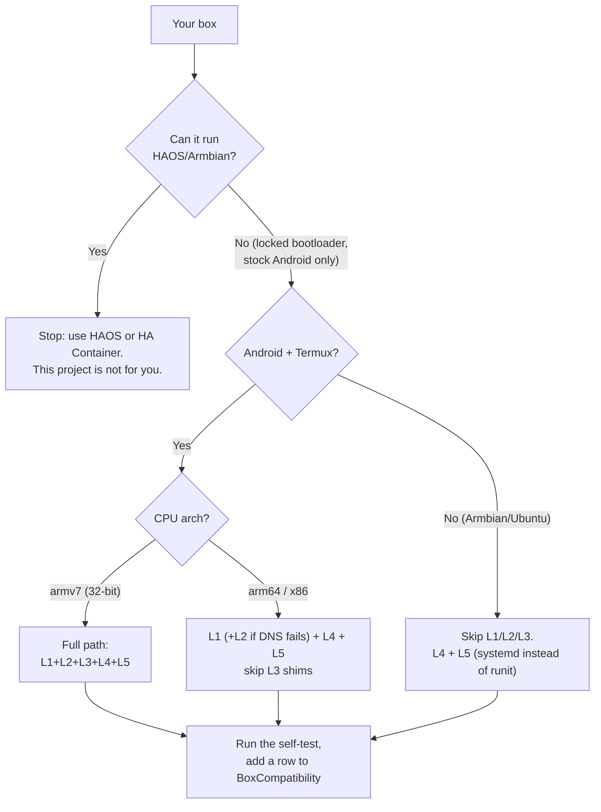

# Porting Guide — running this project on another box

> This project is **not a distro or an installer** — it is a set of scripts + documentation extracted
> from one real deployment (armv7 Android TV box, Termux, HA Core venv). "Porting" means picking the
> pieces you need for **your** hardware and skipping the rest.
>
> Read [Box compatibility list](BoxCompatibility-EN.md) first; then follow the decision tree below.

---

## 1. What you are actually porting

Five independent layers. You only need the ones that apply to your box:

| Layer | Component | Needed when |
|---|---|---|
| L1 Platform patch | `scripts/patch-android-platform.py` | HA Core on **Android/Termux** only |
| L2 DNS fix | `scripts/sitecustomize.py` | Android builds where `pycares.getaddrinfo()` fails (`ENOTIMP`) |
| L3 Dependency shims | `scripts/shims-32bit.py` | **32-bit (armv7)** environments with no prebuilt wheels |
| L4 Integration patches | `patch-midea-d9-default.py`, `patch-d9-programs.py`, `patch-mobile-app-manifest.py` | only when you use those integrations |
| L5 Ops layer | `stability/*` (runit, watchdog, backup, selftest, upgrade) | always, but **must be adapted** to the service manager / paths |

Typical mistake: applying all five everywhere. On arm64 or Armbian you can skip L1/L2/L3 and go
straight to L4/L5.

---

## 2. Decision tree



---

## 2.5 Hard binary dependencies (cannot be shimmed — the platform must provide them)

| Package | Used for | How to get it | Why it cannot be shimmed |
|---|---|---|---|
| **cryptography** | TLS / crypto / hashing; core HA dependency | Termux `pkg install python-cryptography`; Debian `apt install python3-cryptography`; or a matching-arch wheel | Rust implementation; a pure-Python stand-in is slow and unsafe, and HA fails at import |
| bcrypt | password hashing | same (system package) | C extension |
| pillow / numpy / grpcio / psutil | images / numeric / gRPC / processes | same | C/C++ extensions; 32-bit builds easily OOM |

**Check on the target machine:**
```bash
python -c "import cryptography; print(cryptography.__version__, cryptography.__file__)"
```
- A path under the **system site-packages** (e.g. Termux `/data/data/com.termux/files/usr/lib/python3.14/site-packages`) means it comes from the OS package; the venv must use `--system-site-packages` to inherit it.
- `_rust.abi3.so: wrong ELF class` / module not found → that platform has no matching binary. Install it from the package manager; if nothing exists, the machine cannot run HA Core.

## 3. Component reference: symptom → script

| Symptom | Component | Verify |
|---|---|---|
| HA exits: `Home Assistant only supports Linux, macOS...` | `patch-android-platform.py` | `python patch-android-platform.py --check` |
| Cloud logins fail: `Could not contact DNS servers` | `sitecustomize.py` | `python -c "import sitecustomize; print(sitecustomize.STATUS)"` → `patched` |
| `pip install homeassistant` tries to build orjson/ulid/fnv/uv | `shims-32bit.py` | `pip install homeassistant` completes; `python -c "import orjson"` |
| Midea D9 device polled but **0 entities** | `patch-midea-d9-default.py` | device page shows entities |
| Phone app can't connect (404) | `patch-mobile-app-manifest.py` | `curl -s localhost:8123/api/mobile_app`-style check / app connects |
| Watchdog / backup / selftest missing | `stability/*` | `selftest.sh` → `pass=17 fail=0` |
| Need automatic re-patch after HA upgrade | `stability/upgrade.sh --repatch` | `upgrade.sh --verify` |

---

## 4. Porting checklist

### Step 0 — Check the hardware

```bash
uname -m                  # aarch64 = arm64 (easy), armv7l = 32-bit (hard), x86_64 (usually use HAOS instead)
getprop ro.build.version.release   # Android version (Termux path only)
free -m                   # ≥ 2 GB recommended
df -h /data               # ≥ 4 GB free
```

Write the answers down — you'll add them to `BoxCompatibility` at the end.

### Step 1 — Install Termux (only for Android)

- Use the **ABI-matching** Termux build (`arm64-v8a` / `armeabi-v7a` / `x86_64`);
- Install `Termux:Boot` if you want start-on-boot;
- Keep Termux out of battery optimization.

### Step 2 — Python + shims (L3, only if you hit build failures)

```bash
pkg install python git -y
python -m venv ~/ha-venv --system-site-packages
source ~/ha-venv/bin/activate
pip install -U pip
# try installing HA first; only if it fails on orjson/ulid/fnv/uv:
python scripts/shims-32bit.py
```

On arm64/x86 you normally **don't** need this step.

### Step 3 — Install HA Core + platform patch + DNS fix (L1/L2, Android only)

```bash
pip install homeassistant
python scripts/patch-android-platform.py
cp scripts/sitecustomize.py ~/ha-venv/lib/python3.14/site-packages/sitecustomize.py
python -c "import sitecustomize; print(sitecustomize.STATUS)"
```

> `sitecustomize.py` is loaded automatically by the venv Python. If your Python version differs,
> copy it into that version's `site-packages`.

### Step 4 — Minimal config and first start

- No `default_config`, no `recorder` (2 GB boxes);
- Start once, open `http://<box-ip>:8123`, finish onboarding;
- Measure cold start; if > 2 minutes, disable TV apps / unused integrations.

### Step 5 — Integrations and their patches (L4)

Only if you use them:

```bash
# Midea AC/washer/dishwasher (midea_ac_lan)
python scripts/patch-midea-d9-default.py
python scripts/patch-d9-programs.py        # optional: extra D9 program select/buttons

# Companion app connection
python scripts/patch-mobile-app-manifest.py
```

### Step 6 — Services (L5, must be adapted)

**Android/Termux** — use runit (`termux-services`); on this project:

```bash
sv up hass            # main HA service
sv up watchdog        # health/memory/disk watchdog
sv up backup          # weekly backup + monthly drill
```

**Armbian/Debian** — replace runit with systemd units. The scripts stay the same, only the
supervisor changes:

```ini
# /etc/systemd/system/ha-core.service  (example, adapt paths)
[Unit]
Description=Home Assistant Core
After=network-online.target
[Service]
User=ha
WorkingDirectory=/home/ha/.homeassistant
ExecStart=/home/ha/ha-venv/bin/hass -c /home/ha/.homeassistant
Restart=always
RestartSec=5
[Install]
WantedBy=multi-user.target
```

### Step 7 — Ops layer: adapt the hardcoded paths

The `scripts/stability/*` scripts currently hardcode the Termux home
(`/data/data/com.termux/files/home`). On another environment, change the top of each script (or
source a shared `env.sh`, see §5):

- `HA_CONFIG` — HA config directory (`~/.homeassistant`)
- `VENV` — Python venv (`~/ha-venv`)
- `SNAPSHOT_DIR` — where backups/snapshots go
- `LOG_DIR` — log directory

Then run:

```bash
bash scripts/stability/selftest.sh      # expect pass=17 fail=0
```

### Step 8 — Record the result

Add a row to [`BoxCompatibility-EN.md`](BoxCompatibility-EN.md) (or the Chinese table) with:
model, CPU arch, RAM, Android/Linux version, which layers you applied, and status.
This is the single most valuable contribution for the next person.

---

## 5. Path/config abstraction (`scripts/env.sh`, implemented)

Implemented: `scripts/env.sh` provides defaults and env overrides; the stability scripts and `start-ha.sh` source it. Everything can be overridden from the environment:

```bash
# scripts/stability/env.sh  (sourced by all stability scripts)
: "${TERMUX_HOME:=/data/data/com.termux/files/home}"
: "${HA_CONFIG:=$TERMUX_HOME/.homeassistant}"
: "${VENV:=$TERMUX_HOME/ha-venv}"
: "${PYTHON:=$VENV/bin/python}"
: "${SNAPSHOT_DIR:=$TERMUX_HOME/stability/snapshots}"
: "${LOG_DIR:=$TERMUX_HOME/stability/logs}"
```

| Script | Hardcoded today | After env.sh |
|---|---|---|
| `start-ha.sh` | `$HOME`, venv path | `$VENV`, `$HA_CONFIG` |
| `watchdog.sh` | home, logs, HA URL | `$LOG_DIR`, `$HA_URL` |
| `backup-ha.sh` / `backup-schedule.sh` | home, `/sdcard` | `$HA_CONFIG`, `$SNAPSHOT_DIR`, `$BACKUP_DEST` |
| `rollback.sh` / `upgrade.sh` | home, venv | `$VENV`, `$SNAPSHOT_DIR`, `$PYTHON` |
| `selftest.sh` | home, logs | `$LOG_DIR`, `$HA_CONFIG`, `$VENV` |
| `patch-d9-programs.py` | termux home | `--config` / `$HA_CONFIG` |

Acceptance for this refactor: on the reference box, `selftest.sh` still reports `pass=17`, and
`upgrade.sh --preflight` works unchanged.

---

## 6. Maintenance expectations after porting

| Topic | Expectation |
|---|---|
| HA upgrades | re-run `upgrade.sh --all --yes` (snapshot → upgrade → repatch → selftest → rollback on failure) |
| Dependency upgrades | re-run `shims-32bit.py` on 32-bit only |
| Core patches | `--repatch` re-applies platform/DNS/mobile_app/D9 |
| Integrations | device-specific patches may break after integration upgrades — check the integration changelog |
| EOL risk | armv7 is unsupported upstream; pin versions and keep the rollback path tested |

---

## 7. What is **not** portable (by design)

- 32-bit shims are a workaround for missing armv7 wheels — not needed on 64-bit;
- the Android platform/DNS patches only make sense on Android;
- runit/Termux:Boot are Termux-specific (use systemd elsewhere);
- HAOS / HA Container users should not use this project at all;
- Midea device protocol generations differ per model — a patch that works on one washer may be
  useless on another.

---

## 8. Contributing a port

Use the issue template and include:

1. model + CPU arch + RAM + OS version;
2. which layers (L1–L5) you applied and which you skipped;
3. `selftest.sh` output;
4. startup time, memory usage, entity count;
5. anything you had to change (paths, service manager, patch adjustments).

PRs to this guide and to the compatibility table are as valuable as code PRs.

---

## 9. See also

- [Getting Started (EN)](GettingStarted-EN.md)
- [Architecture (EN)](Architecture-EN.md)
- [Troubleshooting (EN)](Troubleshooting-EN.md)
- [Tech Stack (EN)](TechStack-EN.md)
- [Upgrade & Recovery Runbook (EN)](UpgradeRunbook-EN.md)
- [Box compatibility list](BoxCompatibility-EN.md)

---

## 10. Portability matrix by HA install type

| HA install type | This project applies? | What to keep |
|---|---|---|
| HA Core venv on Android/Termux | ✅ yes | L1–L5 |
| HA Core venv on Debian/Armbian | ⚠️ partially | L4 + L5 (replace runit with systemd); skip L1–L3 |
| HA Container (Docker) | ❌ no | only the integration patches may be reusable |
| HAOS | ❌ no | use HAOS; this project is for hardware that can't run it |

## 11. Hardware and peripherals — what to check before porting

| Item | Target | Why it matters |
|---|---|---|
| RAM | ≥ 2 GB (4 GB comfortable) | HA Core + integrations; 1 GB will swap/OOM |
| Storage | eMMC/SD is a wear item; USB SSD preferred | recorder/logs/backups write constantly |
| Cooling | passive boxes throttle; watch temps | a hot box randomly restarts |
| Network | 2.4 GHz Wi-Fi only on many boxes | 5 GHz-only environments need a USB NIC or an AP change |
| Address | give the box a **static/DHCP-reserved IP** | HA URL, integrations and voice bridge all depend on it |
| Timezone/locale | set Asia/Shanghai (or yours) in HA | automations and logs use local time |

## 12. Resource thresholds must be re-tuned

The watchdog defaults were tuned for a 2 GB box. Adjust them for yours:

| Variable | Default (2 GB box) | Tuning hint |
|---|---|---|
| `MEM_MIN_MB` | ~120 MB | 64 MB on 1 GB boxes; 256 MB on 4 GB boxes |
| `DISK_MIN_MB` | ~2048 MB | keep ≥ 2× your backup size |
| `INTERVAL` | 60 s | 120 s on very slow boxes |
| `FAIL_THRESHOLD` | 3 | keep ≥ 3 |
| `COOLDOWN` | 1800 s | keep ≥ 900 s to avoid restart storms |
| start grace | 300 s | raise if your cold start is slower |

## 13. Region / cloud dependencies (the voice path)

| Component | Assumption | Outside that region |
|---|---|---|
| Bemfa Cloud | account + Mi Home (China) binding | use Alexa/Google/HomeKit bridges instead; L5 ops layer still applies |
| Xiaoai voice | Mi Home ecosystem | substitute your local voice assistant + an HA bridge |
| Midea account | China or international account (different APIs) | check which `midea_ac_lan` cloud login your account supports |
| Haier | Haier Smart Home cloud (China app) | `haier` integration may not cover other regions' accounts |

Porting the **ops layer** is region-independent; porting the **voice path** is not.

## 14. Verification matrix (acceptance before calling it "ported")

| # | Check | Command / evidence | Expected |
|---|---|---|---|
| 1 | HA starts | `curl -s -o /dev/null -w '%{http_code}' http://127.0.0.1:8123/` | `200` |
| 2 | Config valid | `hass --script check_config -c ~/.homeassistant` | no errors |
| 3 | Entities live | HA UI → device page | expected entities, not `unavailable` |
| 4 | Services supervised | `sv status hass` (or `systemctl status`) | `run` |
| 5 | Self-test | `bash scripts/stability/selftest.sh` | `pass=17 fail=0` |
| 6 | Backup fresh | `ls -lt ~/stability/backups` | archive < 8 days old |
| 7 | Restore drill | `cat ~/stability/backup-schedule/drill-result` | `PASS` |
| 8 | Upgrade dry-run | `upgrade.sh --preflight` / `--verify` | completes |
| 9 | Voice path | say one command / check Bemfa console | device reacts |
| 10 | Rollback tested | `upgrade.sh --rollback --dry-run` | prints plan, no changes |

## 15. Rollback plan while porting (do this before touching a running box)

1. Backup first: `bash scripts/stability/backup-ha.sh` (or `tar czf` the config yourself);
2. Copy the files you are about to replace (shims in `site-packages`, `sitecustomize.py`, patched HA files) to `~/stability/snapshots/`;
3. Keep the old start method working until the new one is verified;
4. If HA fails to start: restore the copied files, `sv restart hass` (or `kill` the manual process and start the old way), then `tail -100 ~/ha.log`;
5. Worst case: restore the config backup and reinstall HA with the pinned version from `pip freeze`.

Never delete the original backup until the new setup has run for a few days.

## 16. Completeness checklist

- [ ] hardware recorded (model / arch / RAM / OS / storage);
- [ ] decided which layers apply (L1–L5) and which are skipped;
- [ ] HA starts and `check_config` passes;
- [ ] every needed integration loaded, patches applied and verified;
- [ ] voice path works **or** a regional alternative is documented;
- [ ] services auto-start after reboot (runit / systemd);
- [ ] watchdog + backup + self-test installed and thresholds re-tuned;
- [ ] restore drill PASS;
- [ ] upgrade preflight/verify path tested;
- [ ] rollback tested once;
- [ ] a row added to the compatibility table;
- [ ] docs updated with anything you had to change.
