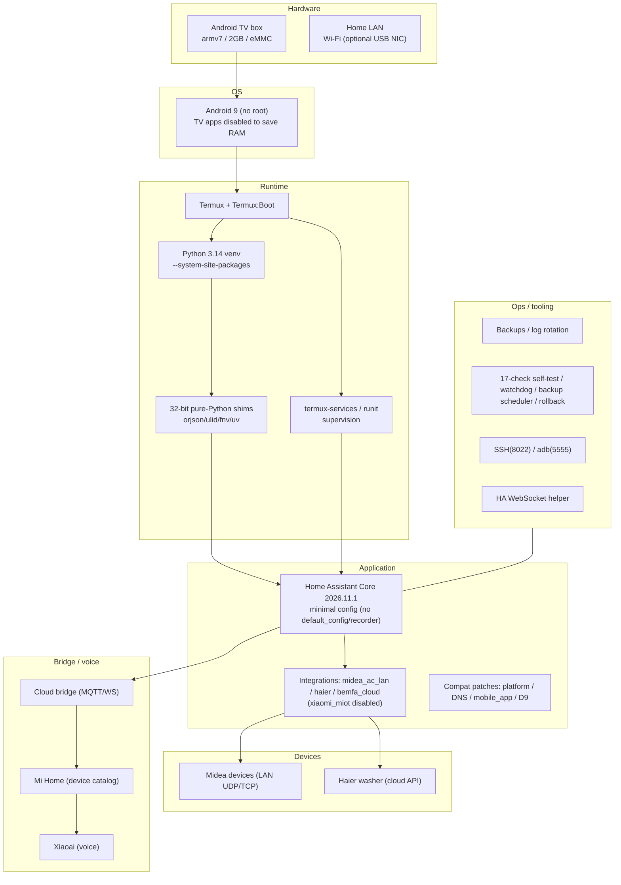

# Tech Stack (layers + rationale)

> What this project uses, **why** it was chosen, **what the alternatives were**, and **what the risks are**.
> Useful for quickly judging the stack — and for explaining "trade-offs under constraints" in an interview.

---

## 0. Overview



---

## 1. Layer inventory

| Layer | Technology | Version (tested) | Role |
|---|---|---|---|
| Hardware | Android TV box | armv7 / 2GB / eMMC | the host |
| OS | Android | 9 (API 28), **no root** | permissions/process/network host |
| Runtime | Termux | 0.119 | Linux user-space |
| Runtime | Termux:Boot | latest | start on boot |
| Supervisor | termux-services / runit | - | process supervision (auto-restart) |
| Language | Python | 3.14.10 | HA runtime |
| Dependency strategy | prebuilt packages + pure-Python shims | - | avoid 32-bit wheel/Rust builds |
| Application | Home Assistant Core | 2026.11.1 | state machine/control/automation/bridge |
| Integration | `midea_ac_lan` | 2026.10.0 | Midea LAN direct |
| Integration | `haier` | 1.3.0 | Haier Smart Home cloud API |
| Integration | `bemfa_cloud` | 0.1.20 | HA ↔ cloud bridge ↔ Mi Home |
| Integration | `xiaomi_miot` | 1.1.6 (**disabled**) | Xiaomi devices (native Mi Home is enough; adding it slows HA) |
| Compat layer | platform / DNS / mobile_app / D9 patches | - | make HA run here and show entities |
| Bridge | cloud bridge (MQTT/WS) | - | device shadow sync |
| Voice | Mi Home + Xiaoai | latest | device catalog + voice entry |
| Ops | logrotate | 3.22.0 | log rotation (5MB×3, copytruncate) |
| Ops | backup script (tar) | - | keep 4 copies, /sdcard + PC |
| Ops | self-test / rollback | - | 17 checks, rollback dry-run by default |
| Ops | watchdog.sh | - | 8123 health probe + mem/disk thresholds + cooldown + alerts |
| Notifications | ha_notify.py | - | Bemfa WeChat push (works when HA is down) + HA persistent notification / notify entities |
| Ops | backup-schedule.sh (runit service `backup`) | - | weekly backup + monthly restore drill |
| Ops | upgrade.sh | - | upgrade runbook: preflight / repatch / verify / rollback |
| Tooling | SSH (openssh) | - | port 8022 remote maintenance |
| Tooling | adb | - | port 5555 rescue channel |
| Tooling | HA WebSocket helper | - | refresh token → access token, script registry changes |
| Docs | Markdown + mermaid + GitHub Actions (lychee) | - | tutorial/architecture/dead-link CI |
| Dev | Windows + PowerShell + AI coding assistant (DSH) | - | remote ops / troubleshooting / doc generation |

---

## 2. Rationale and alternatives, layer by layer

### 2.1 Hardware: an old Android box

| Why | Cost |
|---|---|
| zero-cost idle hardware; lowest barrier | armv7 was dropped by HA (unsupported since 2025.12); eMMC wear; 2GB is tight |

**Alternatives**: mini PC (≈500–800 CNY, x86/SSD, can run HAOS) > ARM SBC (SD cards die) > vendor NAS (2300+ CNY, wasteful just for HA).
**Conclusion**: the box is a "zero-cost validation" path; for long-term stability use a mini PC.

### 2.2 OS: Android (no root)

| Why | Cost |
|---|---|
| the box can't be flashed/rooted; Android is the only available OS | no systemd, no Docker daemon; kernel limits on cgroups/Bluetooth |

**Alternatives**: flashing (not feasible, risky) / HAOS (needs a dedicated image).

### 2.3 Runtime: Termux + runit

| Why | Cost |
|---|---|
| Termux provides a full Linux user-space without root; runit supervises processes | no systemd → `termux-services`; boot start depends on Termux:Boot |

**Alternatives**: manual nohup (no supervision, rejected); rooting (not feasible).

### 2.4 Python dependency strategy: prebuilt packages + pure-Python shims (the hard part)

| Dependency | Problem | Solution |
|---|---|---|
| orjson | no armv7 wheel, Rust build fails | pure-Python JSON layer (`OPT_*`, `Fragment`, non-str key semantics) |
| ulid-transform | no armv7 wheel | pure-Python ULID |
| fnv-hash-fast | no armv7 wheel | pure-Python FNV |
| uv (resolver) | no armv7 wheel | shim: skip satisfied deps + forward `--constraint` |
| cryptography/bcrypt/pillow/numpy/grpcio/psutil | build time / OOM | Termux prebuilt packages, inherited via venv `--system-site-packages` (**cryptography has no pure-Python replacement — it cannot be shimmed**) |
| pip index | slow in China | Tsinghua mirror |

**Effect**: installs went from "fails / hangs for minutes" to workable; cold start **361 s → 38.8 s**.

### 2.5 Home Assistant: Core instead of Supervisor/HAOS

| Option | Feasible | Trade-off |
|---|---|---|
| HAOS (full OS) | ❌ needs flashing | not allowed by the box |
| Supervisor (Docker) | ❌ no Docker daemon in Termux | - |
| **HA Core (venv)** | ✅ only viable | **no add-ons** → supervision/backup/self-test all custom |

**Config trade-offs**: no `default_config` (heavy), no `recorder` (slow eMMC), minimal integrations (<120 entities).

### 2.6 Integration matrix

| Integration | How | Why | Risk |
|---|---|---|---|
| `midea_ac_lan` | LAN UDP 6445 discovery + TCP 6444 encrypted control | no cloud dependency, fast | needs one cloud login for token; not all models supported |
| `haier` | Haier cloud API | only viable cloud path | needs internet; account risk control |
| `bemfa_cloud` | MQTT/WS device shadow | lets Mi Home/Xiaoai control non-Mi devices | cloud dependency, no local fallback, name length limit |
| `xiaomi_miot` | Xiaomi cloud polling | not needed (Mi Home native works) | **disabled**: cloud polling slows startup and uses RAM |

### 2.7 Compat patch matrix (lost on upgrade, must re-apply)

| Patch | Purpose | When it breaks | How to re-apply |
|---|---|---|---|
| `patch-android-platform.py` | allow `sys.platform == "android"` | HA upgrade overwrites file | run script again |
| `sitecustomize.py` | Android DNS fix (pycares → system resolver) | venv rebuild | copy to site-packages |
| `patch-midea-d9-default.py` | fix D9 missing entities | midea_ac_lan upgrade | run again |
| mobile_app manifest patch | remove `cloud` dependency (app can't connect otherwise) | HA upgrade | re-patch |
| 32-bit shims | dependency compatibility | dependency upgrade / venv rebuild | run `shims-32bit.py` again |

### 2.8 Ops & tooling

| Technology | Purpose | Why |
|---|---|---|
| runit | HA supervision | no systemd on Android; restarts in seconds |
| logrotate | log rotation | protect eMMC (5MB×3, copytruncate) |
| backup script | config-level backup | keep 4 copies; push to PC |
| 17-check self-test | health check | automated, actionable, covers fatal paths (watchdog/log/state, backup freshness, backup scheduler, restore drill) |
| rollback script | one-command recovery | dry-run by default, prevents mistakes |
| apt-mark hold | pin Python | prevent `pkg upgrade` from breaking the venv |
| SSH / adb | remote maintenance | SSH daily, adb rescue (works even if SSH dies) |
| HA WebSocket helper | scripted registry changes | web UI can't batch |

---

## 3. Tested version set (working baseline)

```
Android 9 (API 28) + Termux 0.119
Python 3.14.10 (venv --system-site-packages)
Home Assistant Core 2026.11.1
midea_ac_lan 2026.10.0 | haier 1.3.0 | bemfa_cloud 0.1.20 | xiaomi_miot 1.1.6 (disabled)
logrotate 3.22.0 | runit (termux-services)
```

> Before upgrading run `upgrade.sh --preflight`; after upgrading `--repatch` re-applies patches and then runs the 17-check self-test.

---

## 4. Alternatives considered (and rejected)

| Option | Why not |
|---|---|
| Docker / Compose | no Docker daemon in Termux (Android kernel limits) |
| Supervisor / HAOS | needs flashing/dedicated image; the box can't |
| NAS + HA | expensive just for HA (2300+ vs 0); Docker version has no add-ons |
| Exposing 8123/SSH publicly | security risk; use VPN for remote access |
| Vendor IoT cloud platforms | data/cost/control trade-offs; local LAN is steadier |
| HomeKit / Mi Home direct | Midea/Haier aren't natively supported; a bridge is mandatory |

---

## 5. One-line summary (interview answer)

> "The stack is **Android/Termux + Python venv + HA Core + a custom compatibility layer + runit ops**: on a 32-bit platform dropped by upstream, pure-Python shims replace Rust dependencies, platform/DNS patches make HA run, and runit/backup/self-test/rollback replace what Supervisor would give you — delivering a 24/7 usable system."

---

## 6. Known risks (matching the ceiling)

| Risk | Status |
|---|---|
| armv7 no longer supported upstream | pin versions; migration to x86/HAOS is P2 |
| eMMC wear | recorder off, log rotation, off-box backups |
| 2GB RAM | minimal config, heavy integrations disabled, <120 entities |
| Cloud bridge has no local fallback | documented degradation plan (P2) |
| Patches lost on upgrade | original-file backups + scripted re-patch list |
| Single node | backups allow fast reinstall on another box (config level) |
