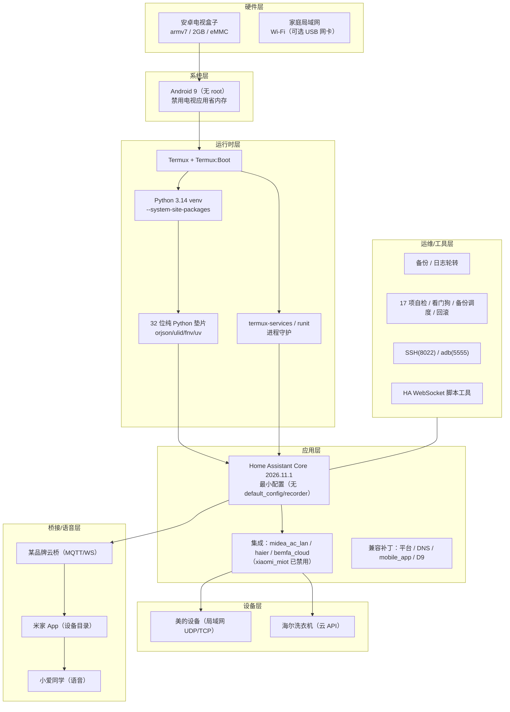

# 技术栈（分层清单 + 选型理由）

> 本文档回答：这个项目用了什么、**为什么选它**、**替代方案是什么**、**有什么风险**。
> 适合读者快速判断技术栈，也适合面试时讲"约束下的取舍"。

---

## 0. 总览



---

## 1. 分层清单

| 层 | 技术 | 版本（实测） | 职责 |
|---|---|---|---|
| 硬件 | 安卓电视盒子 | armv7 / 2GB / eMMC | 运行载体 |
| 系统 | Android | 9（API 28），**无 root** | 权限/进程/网络宿主 |
| 运行时 | Termux | 0.119 | 提供 Linux 用户态 |
| 运行时 | Termux:Boot | 最新 | 开机自启 |
| 守护 | termux-services / runit | - | 进程守护（崩溃自动拉起） |
| 语言 | Python | 3.14.10 | HA 运行环境 |
| 依赖策略 | 预编译包 + 纯 Python 垫片 | - | 绕开 32 位无 wheel/Rust 编译 |
| 应用 | Home Assistant Core | 2026.11.1 | 状态机/控制/自动化/桥接 |
| 集成 | `midea_ac_lan` | 2026.10.0 | 美的局域网直连 |
| 集成 | `haier` | 1.3.0 | 海尔智家云 API |
| 集成 | `bemfa_cloud` | 0.1.20 | HA ↔ 云桥 ↔ 米家 |
| 集成 | `xiaomi_miot` | 1.1.6（**已禁用**） | 小米设备（原生已有，进 HA 反而拖慢） |
| 兼容层 | 平台补丁 / DNS 补丁 / mobile_app 补丁 / D9 补丁 | - | 让 HA 在本平台能跑、设备能显示 |
| 桥接 | 某品牌云桥（MQTT/WS） | - | 设备影子同步 |
| 语音 | 米家 App + 小爱同学 | 最新 | 设备目录 + 语音入口 |
| 运维 | logrotate | 3.22.0 | 日志轮转（5MB×3，copytruncate） |
| 运维 | 备份脚本（tar） | - | 保留 4 份，/sdcard + PC |
| 运维 | 自检 / 回滚脚本 | - | 17 项自检、默认 dry-run 回滚 |
| 运维 | 看门狗 watchdog.sh | - | 8123 健康探测 + 内存/磁盘阈值 + 冷却 + 推送 |
| 通知 | ha_notify.py | - | 巴法云微信推送（HA 挂了也能发）+ HA 常驻通知 / notify 实体 |
| 运维 | backup-schedule.sh（runit 服务 backup） | - | 每周自动备份 + 每月恢复演练 |
| 运维 | upgrade.sh | - | 升级 Runbook：preflight / repatch / verify / rollback |
| 工具 | SSH（openssh） | - | 端口 8022 远程维护 |
| 工具 | adb | - | 端口 5555 急救通道 |
| 工具 | HA WebSocket 脚本 | - | refresh token → access token，脚本化改注册表 |
| 文档 | Markdown + mermaid + GitHub Actions(lychee) | - | 教程/架构/死链 CI |
| 开发 | Windows + PowerShell + AI 编程助手（DSH） | - | 远程操作/排障/文档生成 |

---

## 2. 逐层选型理由与替代方案

### 2.1 硬件：旧安卓盒子

| 为什么 | 代价 |
|---|---|
| 闲置设备 0 成本；门槛最低 | armv7 被 HA 官方淘汰（2025.12 起不支持）；eMMC 有寿命；2GB 内存紧 |

**替代**：迷你主机（500~800 元，x86/SSD，可上 HAOS）＞ ARM 单板机（SD 卡易坏）＞ 某品牌 NAS（2300+，只为 HA 则浪费）。
**结论**：盒子是"0 成本验证方案"，长期稳定建议迷你主机。

### 2.2 系统：Android（无 root）

| 为什么 | 代价 |
|---|---|
| 盒子无法刷机、不能 root；Android 是唯一可用系统 | 无 systemd、无 Docker daemon、内核对 cgroup/蓝牙等有限制 |

**替代**：刷机（不可行，风险高）/ HAOS（需专用镜像）。

### 2.3 运行时：Termux + runit

| 为什么 | 代价 |
|---|---|
| Termux 提供完整 Linux 用户态（无需 root）；runit 提供进程守护 | 无 systemd，服务管理用 `termux-services`；开机自启依赖 Termux:Boot |

**替代**：手动 nohup（无守护，不选）；开 root（不可行）。

### 2.4 Python 依赖策略：预编译包 + 纯 Python 垫片（核心难点）

| 依赖 | 问题 | 方案 |
|---|---|---|
| orjson | armv7 无 wheel，Rust 编译失败 | 纯 Python JSON 兼容层（实现 `OPT_*`、`Fragment`、非字符串 key 语义） |
| ulid-transform | 无 armv7 wheel | 纯 Python ULID 实现 |
| fnv-hash-fast | 无 armv7 wheel | 纯 Python FNV 实现 |
| uv（依赖解析器） | 无 armv7 wheel | 垫片：跳过已满足依赖 + 转发 `--constraint` |
| cryptography/bcrypt/pillow/numpy/grpcio/psutil | 编译耗时/OOM | 直接用 Termux 预编译包 |
| pip 源 | 国内访问慢 | 清华镜像 |

**效果**：安装从"失败/数分钟卡死"到可完成；启动 361s → 38.8s。

### 2.5 Home Assistant：Core 而非 Supervisor/HAOS

| 选项 | 可行性 | 取舍 |
|---|---|---|
| HAOS（完整系统） | ❌ 需刷机 | 盒子不允许 |
| Supervisor（Docker） | ❌ Termux 无 Docker daemon | - |
| **HA Core（venv）** | ✅ 唯一可行 | **无 Add-ons** → 守护/备份/自检全部自建 |

**配置取舍**：不用 `default_config`（重组件）、不用 `recorder`（eMMC 慢）、最小集成（实体 <120）。

### 2.6 集成矩阵

| 集成 | 接入方式 | 为什么 | 风险 |
|---|---|---|---|
| `midea_ac_lan` | 局域网 UDP 6445 发现 + TCP 6444 加密控制 | 不依赖云、响应快 | 首次需云登录取 token；型号支持不全 |
| `haier` | 海尔云 API | 云侧唯一可行路径 | 依赖外网；账号风控 |
| `bemfa_cloud` | MQTT/WS 设备影子 | 让米家/小爱能控制非米家设备 | 云依赖、无本地兜底、名字长度限制 |
| `xiaomi_miot` | 小米云轮询 | 不需要（米家原生可用） | **已禁用**：云轮询拖慢启动、内存占用 |

### 2.7 兼容补丁矩阵（升级会丢，需重打）

| 补丁 | 作用 | 失效场景 | 重打方式 |
|---|---|---|---|
| `patch-android-platform.py` | 放行 `sys.platform == "android"` | HA 升级覆盖 | 重新执行脚本 |
| `sitecustomize.py` | Android DNS 修复（pycares → 系统解析） | venv 重建 | 复制到 site-packages |
| `patch-midea-d9-default.py` | 修复 D9 机型实体不显示 | midea_ac_lan 升级 | 重新执行 |
| mobile_app manifest 补丁 | 去掉 `cloud` 依赖（否则 App 连不上） | HA 升级 | 重新打补丁 |
| 32 位垫片 | 依赖兼容 | 依赖升级/重建 venv | 重新执行 `shims-32bit.py` |

### 2.8 运维与工具

| 技术 | 用途 | 为什么 |
|---|---|---|
| runit | HA 进程守护 | Android 无 systemd；崩溃数秒拉起 |
| logrotate | 日志轮转 | 保护 eMMC（5MB×3，copytruncate） |
| 备份脚本 | 配置级备份 | 保留 4 份覆盖"最新+3 次尝试"；推送到 PC |
| 17 项自检 | 健康检查 | 自动判定、失败可行动、覆盖致命路径（含看门狗服务/日志/状态、备份新鲜度、备份调度服务、恢复演练结果） |
| 回滚脚本 | 一键恢复 | 默认 dry-run，防误操作 |
| apt-mark hold | 锁定 Python | 防 `pkg upgrade` 弄坏 venv |
| SSH / adb | 远程维护 | SSH 日常、adb 急救（SSH 挂了也能进） |
| HA WebSocket 工具 | 脚本化改注册表 | 网页操作无法批量化 |

---

## 3. 实测版本组合（可用基线）

```
Android 9（API 28） + Termux 0.119
Python 3.14.10（venv --system-site-packages）
Home Assistant Core 2026.11.1
midea_ac_lan 2026.10.0 ｜ haier 1.3.0 ｜ bemfa_cloud 0.1.20 ｜ xiaomi_miot 1.1.6（禁用）
logrotate 3.22.0 ｜ runit（termux-services）
```

> 升级前跑 `upgrade.sh --preflight`；升级后 `--repatch` 自动重打补丁，再跑 17 项自检。

---

## 4. 替代方案总表（为什么不选）

| 方案 | 不选的原因 |
|---|---|
| Docker / Compose | Termux 无 Docker daemon（Android 内核限制） |
| Supervisor / HAOS | 需刷机或专用镜像，盒子不允许 |
| NAS + HA | 只为 HA 买 NAS 成本高（2300+ vs 0）；Docker 版无 Add-ons |
| 公网暴露 8123/SSH | 安全风险；远程访问用 VPN |
| 云厂商 IoT 平台 | 数据/费用/可控性差；本地局域网更稳 |
| HomeKit / 米家直连 | 美的/海尔不原生支持，必须桥接 |

---

## 5. 面试用一句话总结

> "技术栈是 **Android/Termux + Python venv + HA Core + 自研兼容层 + runit 运维**：在被官方淘汰的 32 位平台上，用纯 Python 垫片替代 Rust 依赖、用平台/DNS 补丁让 HA 能跑、用 runit/备份/自检/回滚补上没有 Supervisor 的能力，最终交付一个 7×24 可用的系统。"

---

## 6. 已知风险（与天花板一致）

| 风险 | 状态 |
|---|---|
| armv7 不再被官方支持 | 锁版本；迁移 x86/HAOS 已列入 P2 |
| eMMC 磨损 | 关 recorder、日志轮转、备份外置 |
| 2GB 内存 | 最小配置、禁用重负载集成、实体 <120 |
| 云桥无本地兜底 | 文档化降级方案（P2） |
| 补丁随升级丢失 | 备份原文件 + 脚本化重打清单 |
| 单节点 | 备份可快速换机恢复（配置级） |
