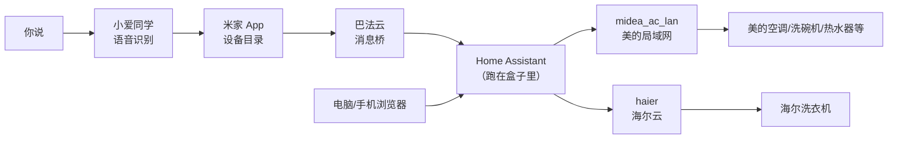

# 教程：安卓盒子从零安装 Home Assistant（小白版）

> 适用：**任意**能装 Termux 的安卓电视盒子 / 旧安卓手机（不需要 root，不需要刷机）
> 目标：盒子变成 7×24 Home Assistant，并且能用小爱同学语音控制美的/海尔等非米家设备
> 阅读方式：**从上到下照做**，每步都有"验收命令"，验收通过再进下一步

---

## 0.0 先看懂架构（5 分钟，强烈建议）

一句话主线：**语音 → 米家 App → 巴法云 → Home Assistant → 集成 → 设备**。



| 角色 | 干什么 | 不干什么 |
|---|---|---|
| 小爱同学 | 听、识别意图、播报 | 不存设备状态、不直连美的 |
| 米家 App | 设备列表、房间、语音路由 | 不执行控制逻辑 |
| 巴法云 | HA ↔ 米家的设备影子桥 | 不做自动化；**设备名有长度限制** |
| Home Assistant | 状态机、控制、自动化、桥接 | 不做语音识别 |
| 小米盒子 | 运行 Termux + HA 进程 | 2GB/32 位/eMMC 是根本约束 |
| 集成 | 协议翻译（美的/海尔/巴法） | 不保证所有型号完整支持 |
| 我们的脚本 | 补丁/兼容/守护 | 不改固件、不绕过付费 |

> 完整版（含时序图、**我们改了什么**、**看门狗机制设计**）见：
> [架构与数据流](架构与数据流.md)

---

## 0. 开始之前：判断你的盒子能不能用

在盒子浏览器/电脑上先确认 4 件事：

| 项目 | 怎么看 | 达标线 |
|---|---|---|
| Android 版本 | 设置 → 关于 | **≥ 7.0** |
| CPU 架构 | 装好 Termux 后敲 `uname -m` | `armv7l`(32 位) 或 `aarch64`(64 位) 都行 |
| 内存 | `free -m` | **≥ 2GB** 较稳（1GB 会频繁卡死） |
| 存储 | `df -h /data` | 空闲 **≥ 3GB** |

> ⚠️ 32 位盒子是"困难模式"：很多 Python 包没有预编译包、需要 Rust 编译。
> 本教程包含**纯 Python 垫片**方案（`scripts/shims-32bit.py`），已把这条链路打通。

---

## 1. 安装 Termux（关键：选对架构）

1. 在盒子上打开浏览器，访问 Termux 官方 GitHub Releases：
   `https://github.com/termux/termux-app/releases`
2. 下载 **debug 版** APK，按盒子架构选：
   - 32 位盒子 → `termux-app_vX.Y.Z+apt-android-7-github-debug_armeabi-v7a.apk`
   - 64 位盒子 → `..._arm64-v8a.apk`
3. 再下载 **Termux:Boot**（同页面 `termux-boot` 仓库）→ 用于开机自启；
4. 安装两个 APK（需要允许"安装未知来源应用"）。

**验收**：打开 Termux，出现 `$` 提示符，敲：
```bash
uname -m        # armv7l 或 aarch64
getprop ro.build.version.release   # 例如 9
```

---

## 2. 基础环境

```bash
# 更新包索引（不要 pkg upgrade 升级全部！）
pkg update

# 安装基础工具
pkg install -y python python-pip clang make pkg-config openssl libffi \
  liblzma libsqlite libjpeg-turbo libxml2 libxslt libsodium git cmake \
  binutils which nano tmux curl openssh

# 让 Termux 不被系统杀掉（必做）
termux-wake-lock
```
再到盒子 **设置 → 应用 → Termux → 电池 → 允许后台运行/不优化**（不同系统叫法不同）。

**验收**：
```bash
python --version      # 3.11+ 即可（教程实测 3.14）
ping -c 2 baidu.com   # 能通 = 网络/DNS 正常
```

---

## 3. 创建 Python 虚拟环境

```bash
python -m venv --system-site-packages ~/ha-venv
source ~/ha-venv/bin/activate
pip install -U pip wheel setuptools
```

> `--system-site-packages` 很重要：让 venv 能用 Termux 预编译的 Python 包（省掉大量编译）。

---

## 4. 安装 Home Assistant（32 位盒子重点看这里）

### 4.1 先装"能预编译"的依赖（有 Termux 包就用包）

```bash
pkg install -y python-cryptography python-bcrypt python-pillow \
  python-numpy python-grpcio python-psutil
```

### 4.2 32 位盒子：安装纯 Python 垫片

HA 依赖的 `orjson / ulid-transform / fnv-hash-fast / uv` 在 32 位下没有预编译包，
需要 Rust 编译。用一个纯 Python 垫片替代（性能略降，功能一致）：

```bash
# 下载并执行本仓库脚本
curl -O https://raw.githubusercontent.com/<你的仓库>/scripts/shims-32bit.py
~/ha-venv/bin/python shims-32bit.py
```

> 64 位盒子一般可以直接 `pip install orjson` 等，不需要垫片。

### 4.3 安装 HA

```bash
pip install homeassistant
hass --version     # 应输出版本号，例如 2026.11.1
```

> 这一步在 2GB 盒子上约 20~40 分钟，**不要中断**。
> 建议先 `tmux`（防止 SSH/网络断开导致安装中断）：`tmux new -s install`。

### 4.4 打 Android 平台补丁（否则 HA 直接拒绝启动）

HA 只接受 Linux/macOS/WSL，Termux 是 Android。用本仓库脚本放行：

```bash
curl -O https://raw.githubusercontent.com/<你的仓库>/scripts/patch-android-platform.py
~/ha-venv/bin/python patch-android-platform.py
```

### 4.5 补 Android 的 DNS 缺陷（否则云登录/插件下载全部失败）

```bash
curl -O https://raw.githubusercontent.com/<你的仓库>/scripts/sitecustomize.py
cp sitecustomize.py ~/ha-venv/lib/python3.*/site-packages/sitecustomize.py
```

**原因**：Android 上 `pycares.getaddrinfo()` 不可用，而 HA 的 HTTP 客户端正好用它，
结果所有外网请求报 `Could not contact DNS servers`。该文件把解析改回系统解析器。

---

## 5. 最小配置 + 首次启动

```bash
mkdir -p ~/.homeassistant
cat > ~/.homeassistant/configuration.yaml <<'YAML'
homeassistant:
  name: Home
  latitude: 30.2741
  longitude: 120.1551
  elevation: 10
  unit_system: metric
  time_zone: Asia/Shanghai
  country: CN

frontend:
config:
onboarding:
person:
sun:
automation: !include automations.yaml
script: !include scripts.yaml
scene: !include scenes.yaml

logger:
  default: warning
YAML

# 启动（放后台、写日志）
nohup sh ~/start-ha.sh >/dev/null 2>&1 &
tail -f ~/ha.log        # 看到 "Home Assistant initialized" 即成功
```

> **不要**用 `default_config:`：它会拉起蓝牙/语音/流媒体等重组件，2GB 盒子会崩。
> **不要**开 `recorder:`：sqlite 在 eMMC 上极慢，是"每次启动等好几分钟"的主因。

**验收**：电脑浏览器打开 `http://<盒子IP>:8123`，能打开初始化页面并创建账号。

> 若页面卡在"正在启动"，检查：
> - `grep -c 'Home Assistant initialized' ~/ha.log` 是否 ≥1
> - `grep -c ERROR ~/ha.log`
> - 内存是否够（`free -m` 的 available）

---

## 6. 安装常用集成（HACS 离线安装法）

盒子上访问 GitHub 通常被墙，**不要**在盒子里装 HACS 商店，改用：

1. 电脑（开 VPN）下载集成 zip（HACS / GitHub Releases）；
2. `scp` 或 adb 推到盒子；
3. 解压到 `~/.homeassistant/custom_components/<组件名>/`；
4. `sv restart hass`（或重启 HA）。

本教程实测可用集成：
- **midea_ac_lan**（美的局域网直连，空调/洗碗机/热水器/洗衣机）
- **haier**（海尔智家）
- **xiaomi_miot**（小米设备，可选；若只需要小爱控制非小米设备可不装）
- **bemfa_cloud**（HA → 巴法云 → 米家 → 小爱）

> 美的用户注意：D9 复式洗烘一体机有 bug（实体不显示），用
> `scripts/patch-midea-d9-default.py` 修复。

---

## 7. 小爱同学语音控制（巴法云桥接）

链路：`HA 设备 → 巴法云 → 米家「其他平台设备」→ 小爱同学`

1. 注册 `https://cloud.bemfa.com`，拿到 **私钥/UID**；
2. HA：设置 → 设备与服务 → 添加集成 → 搜索 **Bemfa Cloud** → 密钥方式填 UID；
3. 勾选要同步的实体（**名字要短**！巴法云数据库字段有限，汉字 ≤ 约 20 字）；
4. 米家 App → 我的 → 其他平台设备 → 添加 → **巴法** → 登录巴法账号；
5. 设备出现在米家后，进设备 → 设置 → **房间**，之后小爱即可控制。

**小爱能说什么**：开关/空调温度/模式等固定句型；**开放式提问**（"现在怎么样"）不支持。
传感器类只支持温度/湿度/开关查询。

> 本仓库 `scripts/bemfa-cleanup.py` 可批量清理巴法云里多余的旧设备/改名。

---

## 8. 稳定性：让盒子 7×24 不崩

| 措施 | 做法 |
|---|---|
| 崩溃自愈 | 安装 `termux-services`，把 HA 做成 runit 服务（`scripts/start-ha.sh`） |
| 自动备份 | `scripts/stability/backup-ha.sh`，保留最近 4 份 |
| 日志轮转 | `logrotate` 规则，5MB×3，copytruncate |
| 版本锁定 | `apt-mark hold python python-pip`（防止 `pkg upgrade` 弄坏 venv） |
| 一键回滚 | `scripts/stability/rollback.sh`（默认 dry-run） |
| 自测 | `scripts/stability/selftest.sh`（11 项检查） |

```bash
# runit 服务化示例
pkg install -y termux-services
mkdir -p $PREFIX/var/service/hass
cat > $PREFIX/var/service/hass/run <<'EOF'
#!/data/data/com.termux/files/usr/bin/sh
exec /data/data/com.termux/files/home/start-ha.sh
EOF
chmod +x $PREFIX/var/service/hass/run
export SVDIR=$PREFIX/var/service
(service-daemon start >/dev/null 2>&1 &)
sv-enable hass
sv status hass
```

**验收**：`kill -9` 掉 HA 进程，30 秒内网页自动恢复 = 守护成功。

---

## 9. 远程维护（电脑连盒子）

```bash
# 盒子：设置 SSH 密码并启动
passwd
export SVDIR=$PREFIX/var/service
sv-enable sshd
```

```powershell
# 电脑 PowerShell：连接（端口 8022）
ssh -p 8022 u0_a37@<盒子IP>
```
> 盒子 IP 会变？路由器里给盒子 **Wi-Fi MAC 做 DHCP 静态绑定**。
> 盒子没有网口是正常的（电视盒子大多没有）；想要有线可买 **USB 转 RJ45 网卡**
> （RTL8152/RTL8153 芯片），插上后 `ifconfig eth0` 有 IP 即成功。

---

## 10. 常见故障排查（真实踩坑表）

| 现象 | 原因 | 解决 |
|---|---|---|
| `INSTALL_FAILED_NO_MATCHING_ABIS` | 装了 64 位 APK，盒子是 32 位 | 换 `armeabi-v7a` 版本 |
| `pkg` 安装卡在 conffile 提问 | 无终端交互 | `DEBIAN_FRONTEND=noninteractive` |
| pip 卡在 `Installing build dependencies` | 每个 sdist 都在编 maturin(Rust) | 用预编译包 + 纯 Python 垫片 |
| `platform android is not supported` | psutil 拒绝 Android | 用 Termux 预编译 `python-psutil` |
| `Home Assistant only supports Linux...` | 平台检查 | 打 `patch-android-platform.py` |
| `Specified configuration directory does not exist` | 没建配置目录 | `mkdir -p ~/.homeassistant` |
| 前端 `SyntaxError ... in JSON` | 32 位 JSON 垫片 bug | 用仓库最新 `shims-32bit.py` |
| `Could not contact DNS servers` | Android pycares 缺陷 | 放 `sitecustomize.py` |
| 云登录全部失败 | 同上（DNS） | 同上 |
| 启动要好几分钟 | `recorder` / `default_config` | 都不要开 |
| 盒子十几分钟掉线一次 | 2GB 内存压力 / 2.4G Wi-Fi | 禁用电视应用、路由器固定 IP/信道、USB 网卡 |
| 米家刷不出巴法设备 | 名字过长/未重绑 | 实体改短名后重新保存巴法配置，米家解绑重绑 |
| 巴法 `v_name too long` | 设备名超长 | 改短实体名（≤20 字） |
| iPhone App 连不上 | `mobile_app` 组件被 cloud 依赖拖死 | 去掉 mobile_app 的 cloud 依赖（见 docs 进阶） |
| 美的云风控 | 短时间内反复登录 | 一次登录批量取 token；冷却 12~24h |
| 内存不足 | 实体太多 | 禁用不用的实体/集成，目标 <120 实体 |

---

## 11. 安全与合规

- 不要 root、不要刷机，保持系统可恢复；
- 所有密钥/密码/UID **不要提交到 GitHub**；
- SSH 只开局域网，不要映射到公网；
- 修改第三方 App/云接口请遵守其用户协议，本项目仅做个人局域网集成。

---

## 12. 性能参考（32 位 2GB 盒子实测）

| 指标 | 数值 |
|---|---|
| HA 启动 | 40~90 秒（优化后） |
| 内存占用 | 1.0~1.5GB（含系统） |
| 实体数 | <120 较稳 |
| 连续运行 | 已实测 5 天+（配合 runit 守护） |

---

## 13. 新手最容易卡住的 12 个点（提前看，少走弯路）

| # | 卡点 | 怎么解决 |
|---|---|---|
| 1 | 盒子没有键盘/鼠标，怎么敲命令 | 插 **USB 键盘**（或蓝牙键鼠）；也可以用另一台电脑 `adb shell` 远程输入 |
| 2 | 不知道怎么找盒子 IP | 盒子：设置 → 网络 → 当前 Wi-Fi 详情；或路由器后台"已连接设备"；电脑 `ping` 试 |
| 3 | APK 怎么装到盒子 | U 盘拷入后用文件管理器安装；或电脑 `adb install xxx.apk` |
| 4 | `nano` 进去后不知道怎么退出 | `Ctrl+O` 回车保存 → `Ctrl+X` 退出。实在不会就用 `cat > 文件 <<'EOF' ... EOF` 写法 |
| 5 | GitHub 打不开、下载失败 | 用电脑（VPN）下载，再 U 盘/`scp`/adb 传到盒子 |
| 6 | `pip install` 特别慢 | 换清华镜像：`pip config set global.index-url https://pypi.tuna.tsinghua.edu.cn/simple` |
| 7 | 命令敲错、找不到命令 | `Tab` 自动补全、`↑` 翻历史；先确认 `source ~/ha-venv/bin/activate` 是否激活 |
| 8 | 不知道自己当前在哪个目录 | `pwd` 看路径、`ls` 看文件 |
| 9 | `pkg` 卡住/反复问 Y | 加 `-y`；或设 `DEBIAN_FRONTEND=noninteractive` |
| 10 | HA 页面打不开 | 先 `ping 盒子IP`、再 `curl -I http://盒子IP:8123`，然后看 `tail -50 ~/ha.log` |
| 11 | 盒子卡死/黑屏 | 断电重启；开机脚本 + runit 会自动拉起 HA |
| 12 | 改了配置后 HA 起不来 | 用仓库里的 `stability/rollback.sh --yes` 回滚，或从备份 tar 恢复 |

---

## 14. 卡住了怎么求助（含 AI 助手）

### 14.1 求助前先收集这 5 样（别人/AI 才能帮你）

```bash
uname -m                      # CPU 架构
getprop ro.build.version.release   # Android 版本
~/ha-venv/bin/hass --version   # HA 版本
tail -n 100 ~/ha.log           # 最近的报错（★最重要）
# 你刚执行了什么命令、期望什么、实际发生了什么
```

> ⚠️ 发出去之前**删掉**：IP、MAC、账号、密码、token、巴法云 UID、设备序列号。

### 14.2 推荐求助渠道

| 渠道 | 适合 |
|---|---|
| 本仓库 **Issues** | 安装/兼容性问题（我会按模板看） |
| HA 中文社区 `bbs.hassbian.com` | HA 本身的问题 |
| **AI 助手**（DeepSeek、ChatGPT、Claude、**DSH/DeepSeek Harness** 等） | 逐条解释命令、解读报错、给下一步命令 |

### 14.3 让 AI 助手帮你装的"提示词模板"（复制即用）

```text
我在用安卓电视盒子（型号：___，架构：armv7/arm64，Android 版本：___，内存：___GB）
按这个教程安装 Home Assistant，现在卡在【第 X 步：___】。
我执行的命令是：___
报错信息是：___
请一步一步告诉我接下来该敲什么命令，并解释每条命令的作用。
不要跳过验收步骤；如果我不确定，请让我先运行验证命令。
我的环境是 Termux（Android），不是普通 Linux。
```

> 本项目在开发/排障过程中也使用了 **DSH（DeepSeek Harness）** 作为 AI 编程助手，
> 用它批量执行命令、解读日志、自动修复配置——你也可以用它来加速自己的安装过程。