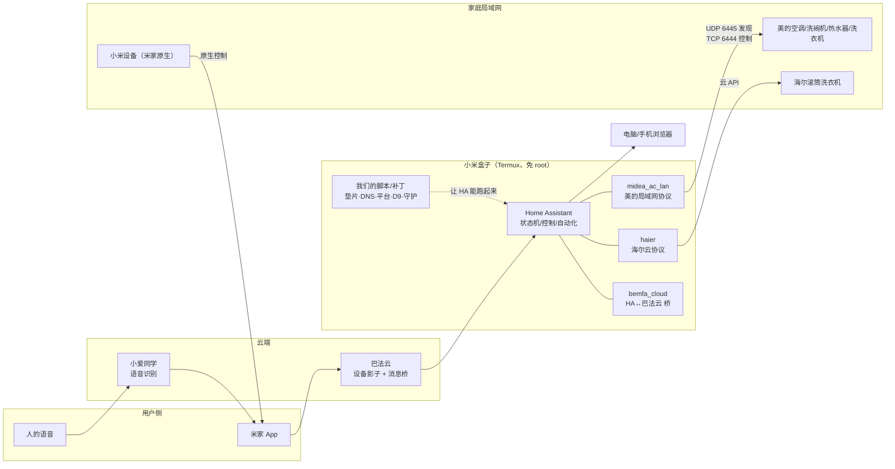
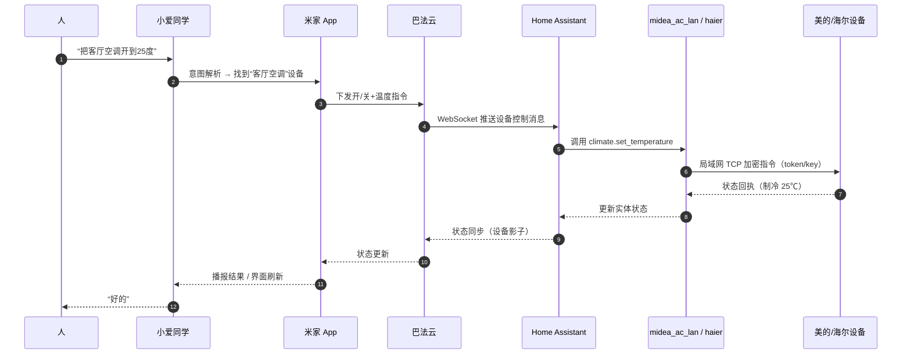
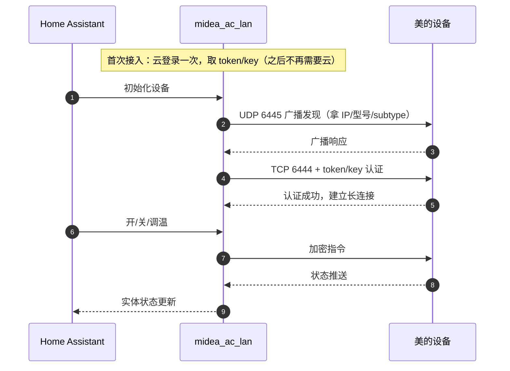
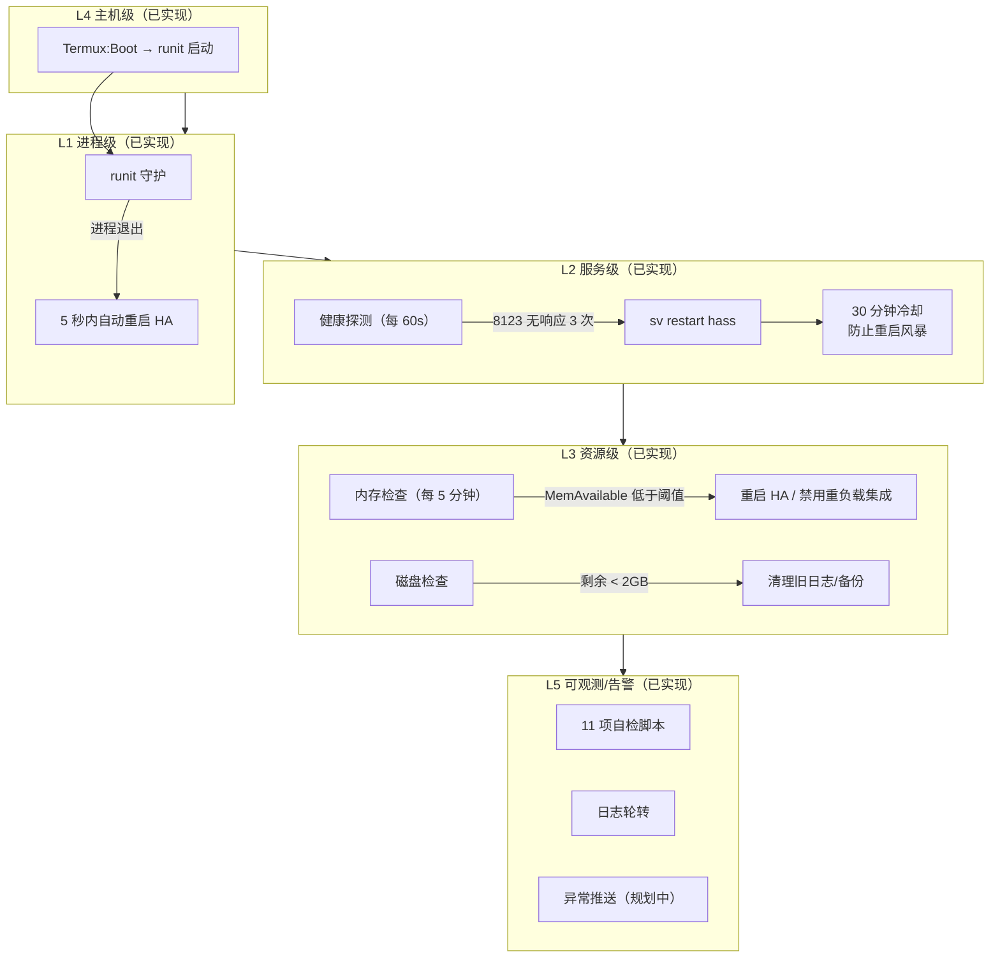
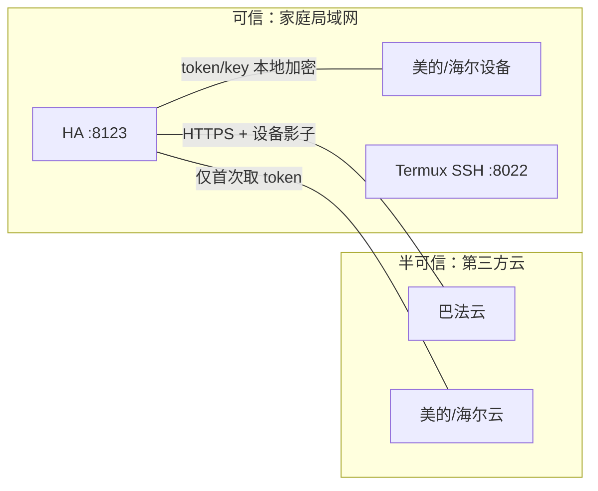

# 架构、角色分工与设计说明

> 先看懂"谁负责什么"，再动手装。这一页解释：小爱/巴法云/米家/HA/盒子/集成/脚本 各自的角色，
> 我们对程序做了哪些改造、为什么改，以及看门狗（自愈）机制的设计思路。

---

## 1. 角色分工（一句话版）

| 角色 | 它是什么 | 负责 | **不负责** |
|---|---|---|---|
| **小爱同学** | 语音入口 | 听、意图识别、播报 | 不存设备状态、不直连美的/海尔 |
| **米家 App** | 设备目录 + 语音路由 | 展示设备、房间归属、把语音指令转给平台 | 不执行设备控制逻辑 |
| **巴法云** | 云桥（MQTT/WS） | 在 HA 与米家之间双向同步设备影子 | 不做自动化、不存业务逻辑；**设备名有长度限制** |
| **Home Assistant** | 控制中枢 | 状态机、控制、自动化、桥接、自愈 | 不负责语音识别（那是小爱的活） |
| **小米盒子** | 运行载体 | 跑 Termux + Linux 进程（HA/脚本） | 不参与业务逻辑；**2GB/32 位/eMMC 是根本约束** |
| **集成**（midea_ac_lan / haier / bemfa_cloud / xiaomi_miot） | 协议翻译 | 把 HA 指令翻译成设备协议 | 不保证对每个型号都完整支持 |
| **我们的脚本/补丁** | 兼容层 | 让"不支持的平台/设备"能跑起来 | 不改官方设备固件、不绕过付费功能 |

> 记住这条主线：**语音 → 米家 → 巴法云 → HA → 集成 → 设备**，回程状态原路返回。

---

## 2. 总体架构

---

## 3. 一条语音指令的完整时序

> 关键点：**小爱不直接连美的**。它只认米家里的设备，而美的/海尔在米家里"不存在"，
> 是巴法云把它们"伪装"成第三方设备，所以 HA 必须在线并维持与巴法云的连接。

---

## 4. 美的设备：局域网直连（不经云）

> 为什么云登录一次就够：**日常控制走局域网**，断外网也能控；
> 只有首次取 token 和极少数云功能需要外网。这也是规避美的云风控的关键。

---

## 5. 我们对程序做了哪些改造（为什么改）

| # | 改造点 | 为什么必须改 | 位置/脚本 | 效果 |
|---|---|---|---|---|
| 1 | **放行 Android 平台** | HA 只允许 Linux/macOS/WSL，Termux 是 android，直接 `sys.exit(1)` | `patch-android-platform.py` | HA 能启动 |
| 2 | **Android DNS 修复** | `pycares.getaddrinfo()` 在 Android 不可用，HA 的 HTTP 客户端正好用它 → 所有外网请求报 `Could not contact DNS servers` | `sitecustomize.py` | 云登录、插件安装恢复 |
| 3 | **32 位纯 Python 垫片** | armv7 无 orjson/ulid/fnv/uv 预编译包，现场编译 Rust 会卡死/OOM | `shims-32bit.py` | 安装成功；启动从数分钟降到 13~40 秒 |
| 4 | **最小配置** | `default_config` 拉起蓝牙/语音/流媒体；`recorder` 在 eMMC 上迁移极慢 | `configuration.yaml` 模板 | 启动 40~90 秒、内存可控 |
| 5 | **美的 D9 补丁** | 上游集成里 D9（复式洗烘一体机）实体配置缺 `default` 标记 → 设备在轮询但 0 实体 | `patch-midea-d9-default.py` | 生成 30 个实体 |
| 6 | **mobile_app 去 cloud 依赖** | `mobile_app` 的 after_dependencies 含 `cloud` → 需要 openai → jiter/pydantic 需 Rust → 安装失败 → App 连不上 | manifest 补丁 | iPhone/Android App 可连 |
| 7 | **巴法云命名适配** | 巴法云 DB 设备名列有长度上限，超长报 `v_name too long` | 实体短名 + `bemfa-cleanup.py` | 同步成功、米家里无垃圾设备 |
| 8 | **runit 服务化** | 裸 `nohup` 进程崩了没人拉起 | `stability/runit-setup.sh` | `kill -9` 后数秒拉起 |
| 9 | **日志轮转 / 备份 / 自检 / 回滚** | eMMC 写入寿命、配置无备份 | `stability/*` | 可恢复、可观测 |
| 10 | **系统侧减负** | 2GB 内存被电视应用/小米云轮询挤占 | `pm disable-user` 禁用电视应用；禁用 xiaomi_miot | 启动耗时 361s → 38.8s |
| 11 | **HA WebSocket 自动化通道** | 很多操作只能网页点，无法脚本化排障 | `ha-ws-probe.py` | 程序化改名/分区/reload |
| 12 | **版本锁定** | 一次 `pkg upgrade` 可能升级 Python 弄坏 venv | `apt-mark hold python python-pip` | 升级不会"某天突然全挂" |

> 原则：**只改"让程序能跑"的最小必要面**，不改设备固件、不绕过付费功能、不违背第三方协议。

---

## 6. 看门狗（自愈）机制设计

### 6.1 分层的自愈设计

### 6.2 为什么这么设计

| 层级 | 能救什么 | 救不了什么 |
|---|---|---|
| L1 runit | 进程崩溃/被系统杀 | 进程活着但服务假死 |
| L2 健康探测 | 假死（端口无响应） | 内存缓慢泄漏 |
| L3 资源看门狗 | 内存/磁盘耗尽 | 硬件故障 |
| L4 开机自启 | 断电/重启 | 运行中崩溃（由 L1 管） |
| L5 自检/告警 | 让人提前发现问题 | 自动修复 |

**核心思想**：每一层只解决一类问题，靠"分工 + 冷却 + 可观测"避免"看门狗自己把系统重启成砖"。
例如 L2/L3 的自动重启必须带 **30 分钟冷却** 和"启动中不判定"，否则会陷入重启风暴。

### 6.3 当前实现状态

| 机制 | 状态 |
|---|---|
| runit 进程守护（崩溃数秒拉起） | ✅ 已实现并实测（`kill -9` 后约 20 秒恢复网页） |
| Termux:Boot 开机自启（runit + sv up） | ✅ 已实现（脚本模拟通过，真实断电待验证） |
| 日志轮转（logrotate + runit 每日） | ✅ 已实现 |
| 备份（脚本 + 保留 4 份） | ✅ 已实现；定时任务待加 |
| 11 项自检 / 一键回滚 | ✅ 已实现 |
| 8123 健康探测 + 自动重启（带冷却） | ✅ 已实现（60s 探测 / 3 次失败 / 30 分钟冷却 / 启动宽限 300s） |
| 内存/磁盘阈值看门狗 | ✅ 已实现（内存 <120MB 重启；磁盘 <2GB 清理旧备份并告警） |
| 异常推送（巴法云微信 / HA 通知） | ✅ 已实现（微信推送需在巴法云绑定微信；iOS 推送需 Nabu Casa，否则用 HA 常驻通知） |

---

## 7. 信任边界与安全

- **不把 8123 / SSH 暴露到公网**；需要外网访问时用 VPN（如 WireGuard/Tailscale）；
- 美居/海尔账号密码只用于**首次取 token**，之后日常控制走局域网；
- 巴法云 UID 视为密钥，不写进仓库、不截图外发；
- 设备 token/key 存于 `.storage`，随备份加密保管。

---

## 8. 一张表总结数据流

| 节点 | 输入 | 输出 | 失败时现象 |
|---|---|---|---|
| 小爱 | 语音 | 意图 | "听不懂"/"没有这个设备" |
| 米家 | 意图 | 平台指令 | 设备列表为空（未绑定巴法） |
| 巴法云 | 平台指令 | 设备影子消息 | 米家设备离线、HA 状态不更新 |
| HA | 影子消息 | 集成调用 | 8123 打不开、实体 unavailable |
| 集成 | HA 调用 | 设备协议 | 云登录失败/token 失效 |
| 设备 | 协议指令 | 物理动作 + 回执 | 空调不响应/局域网不通 |
