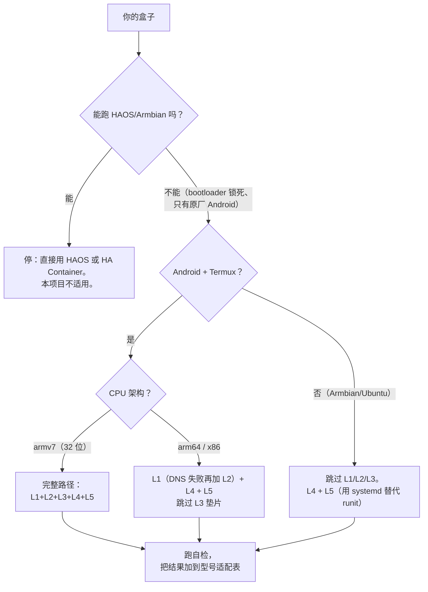

# 移植指南：把这套方案搬到别的盒子上

> 本项目**不是一个发行版或安装器**，而是一套从真实部署（armv7 安卓电视盒子 + Termux + HA Core venv）里抽出来的脚本和文档。
> "移植"的意思是：**按你的硬件挑需要的部分，跳过不需要的部分**，而不是全部照搬。
>
> 先看[盒子型号适配表](盒子型号适配表.md)，再按下面的决策树走。

---

## 1. 你到底在移植什么

五个相互独立的层，按需选用：

| 层 | 组件 | 什么时候需要 |
|---|---|---|
| L1 平台放行 | `scripts/patch-android-platform.py` | 仅 **Android/Termux** 上的 HA Core |
| L2 DNS 修复 | `scripts/sitecustomize.py` | Android 上 `pycares.getaddrinfo()` 报 `ENOTIMP` 的环境 |
| L3 依赖垫片 | `scripts/shims-32bit.py` | **32 位 (armv7)** 且没有预编译 wheel 的环境 |
| L4 集成补丁 | `patch-midea-d9-default.py`、`patch-d9-programs.py`、`patch-mobile-app-manifest.py` | 只有用到对应集成时才需要 |
| L5 运维层 | `stability/*`（runit / 看门狗 / 备份 / 自检 / 升级） | 一般都需要，但**必须按新的服务管理器/路径改造** |

常见错误：五个层全部照搬。arm64 或 Armbian 上 L1/L2/L3 可以直接跳过，只做 L4/L5。

---

## 2. 决策树



---

## 3. 组件速查：现象 → 用哪个脚本

| 现象 | 组件 | 验证方式 |
|---|---|---|
| HA 退出：`Home Assistant only supports Linux, macOS...` | `patch-android-platform.py` | `python patch-android-platform.py --check` |
| 云登录失败：`Could not contact DNS servers` | `sitecustomize.py` | `python -c "import sitecustomize; print(sitecustomize.STATUS)"` → `patched` |
| `pip install homeassistant` 卡在编译 orjson/ulid/fnv/uv | `shims-32bit.py` | 安装能完成；`python -c "import orjson"` |
| 美的 D9 设备在轮询但**0 实体** | `patch-midea-d9-default.py` | 设备页面出现实体 |
| 手机 App 连不上（404） | `patch-mobile-app-manifest.py` | App 能连接 |
| 看门狗/备份/自检缺失 | `stability/*` | `selftest.sh` → `pass=17 fail=0` |
| HA 升级后要自动重打补丁 | `stability/upgrade.sh --repatch` | `upgrade.sh --verify` |

---

## 4. 移植检查清单

### 第 0 步：确认硬件

```bash
uname -m                  # aarch64=arm64（简单），armv7l=32 位（困难），x86_64（一般直接用 HAOS）
getprop ro.build.version.release   # 仅 Android/Termux 路径
free -m                   # 建议 ≥ 2GB
df -h /data               # 建议 ≥ 4GB 可用
```

把结果记下来，最后填进型号适配表。

### 第 1 步：装 Termux（仅 Android）

- 用 **ABI 匹配**的 Termux 包（`arm64-v8a` / `armeabi-v7a` / `x86_64`）；
- 需要开机自启就装 `Termux:Boot`；
- 把 Termux 排除在电池优化之外。

### 第 2 步：Python + 垫片（L3，只在安装失败时需要）

```bash
pkg install python git -y
python -m venv ~/ha-venv --system-site-packages
source ~/ha-venv/bin/activate
pip install -U pip
# 先直接装 HA；只有卡在 orjson/ulid/fnv/uv 时才执行：
python scripts/shims-32bit.py
```

arm64/x86 一般**不需要**这一步。

### 第 3 步：装 HA Core + 平台补丁 + DNS 修复（L1/L2，仅 Android）

```bash
pip install homeassistant
python scripts/patch-android-platform.py
cp scripts/sitecustomize.py ~/ha-venv/lib/python3.14/site-packages/sitecustomize.py
python -c "import sitecustomize; print(sitecustomize.STATUS)"
```

> `sitecustomize.py` 由 venv 的 Python 自动加载；换 Python 版本时复制到对应版本的 `site-packages`。

### 第 4 步：最小配置 + 首次启动

- 不用 `default_config`、不用 `recorder`（2GB 盒子）；
- 启动后访问 `http://<盒子IP>:8123` 完成初始化；
- 记录冷启动时间；超过 2 分钟就禁用电视应用/用不到的集成。

### 第 5 步：集成与对应补丁（L4）

只在用的时候执行：

```bash
# 美的空调/洗衣机/洗碗机（midea_ac_lan）
python scripts/patch-midea-d9-default.py
python scripts/patch-d9-programs.py        # 可选：D9 程序选择/按钮

# 手机 App 连接
python scripts/patch-mobile-app-manifest.py
```

### 第 6 步：服务层（L5，必须改造）

**Android/Termux**：用 runit（`termux-services`）：

```bash
sv up hass            # HA 主服务
sv up watchdog        # 健康/内存/磁盘看门狗
sv up backup          # 每周备份 + 每月演练
```

**Armbian/Debian**：把 runit 换 systemd，脚本本身不变，只换守护方式：

```ini
# /etc/systemd/system/ha-core.service（示例，路径按实际改）
[Unit]
Description=Home Assistant Core
After=network-online.target
[Service]
User=ha
WorkingDirectory=/home/ha/.homeassistant
ExecStart=/home/ha/ha-venv/bin/hass -c /home/ha/.homeassistant
Restart=always
RestartSec=5
[Install]
WantedBy=multi-user.target
```

### 第 7 步：运维层——改掉硬编码路径

`scripts/stability/*` 目前硬编码 Termux home（`/data/data/com.termux/files/home`）。换环境时改每个脚本开头的变量（或统一 source `env.sh`，见第 5 节）：

- `HA_CONFIG`——HA 配置目录（`~/.homeassistant`）
- `VENV`——Python venv（`~/ha-venv`）
- `SNAPSHOT_DIR`——备份/快照目录
- `LOG_DIR`——日志目录

然后运行：

```bash
bash scripts/stability/selftest.sh      # 期望 pass=17 fail=0
```

### 第 8 步：登记结果

在[盒子型号适配表](盒子型号适配表.md)加一行：型号、CPU 架构、内存、系统版本、用了哪几层、状态。
这是对后来者最有价值的贡献。

---

## 5. 计划中的路径/配置抽象（env.sh）

目前有 10 个脚本硬编码 Termux 路径。计划改造（尚未合并）：

```bash
# scripts/stability/env.sh（由所有 stability 脚本 source）
: "${TERMUX_HOME:=/data/data/com.termux/files/home}"
: "${HA_CONFIG:=$TERMUX_HOME/.homeassistant}"
: "${VENV:=$TERMUX_HOME/ha-venv}"
: "${PYTHON:=$VENV/bin/python}"
: "${SNAPSHOT_DIR:=$TERMUX_HOME/stability/snapshots}"
: "${LOG_DIR:=$TERMUX_HOME/stability/logs}"
```

| 脚本 | 当前硬编码 | 改造后 |
|---|---|---|
| `start-ha.sh` | `$HOME`、venv 路径 | `$VENV`、`$HA_CONFIG` |
| `watchdog.sh` | home、logs、HA URL | `$LOG_DIR`、`$HA_URL` |
| `backup-ha.sh` / `backup-schedule.sh` | home、`/sdcard` | `$HA_CONFIG`、`$SNAPSHOT_DIR`、`$BACKUP_DEST` |
| `rollback.sh` / `upgrade.sh` | home、venv | `$VENV`、`$SNAPSHOT_DIR`、`$PYTHON` |
| `selftest.sh` | home、logs | `$LOG_DIR`、`$HA_CONFIG`、`$VENV` |
| `patch-d9-programs.py` | termux home | `--config` / `$HA_CONFIG` |

验收标准：在参考盒子上改完后 `selftest.sh` 仍然 `pass=17`，且 `upgrade.sh --preflight` 正常。

---

## 6. 移植后的维护预期

| 事项 | 预期 |
|---|---|
| HA 升级 | 跑 `upgrade.sh --all --yes`（快照→升级→自动重打补丁→自检→失败回滚） |
| 依赖升级 | 仅 32 位环境需要重跑 `shims-32bit.py` |
| 核心补丁 | `--repatch` 自动重打平台/DNS/mobile_app/D9 |
| 集成升级 | 设备相关补丁可能失效，注意集成 changelog |
| EOL 风险 | armv7 已不被官方支持，锁版本并保持回滚可用 |

---

## 7. 天然不可移植的部分

- 32 位垫片是"缺 armv7 wheel"的补丁，64 位上不需要；
- Android 平台/DNS 补丁只在 Android 上有意义；
- runit/Termux:Boot 是 Termux 特有（其它环境用 systemd）；
- HAOS / HA Container 用户不应使用本项目；
- 美的设备协议代际不同，一台机器能用的补丁到另一台可能无效。

---

## 8. 贡献一次移植

用 Issue 模板，附上：

1. 型号 + CPU 架构 + 内存 + 系统版本；
2. 用了哪几层（L1–L5），跳过了哪些；
3. `selftest.sh` 输出；
4. 启动时间、内存占用、实体数；
5. 你改了什么（路径、服务管理器、补丁调整）。

**对本文档和型号适配表的 PR 和代码 PR 一样有价值。**

---

## 9. 相关文档

- [教程：安卓盒子从零安装 Home Assistant](教程-安卓盒子装HomeAssistant.md)
- [架构与数据流](架构与数据流.md)
- [技术栈](技术栈.md)
- [升级与恢复 Runbook](升级与恢复Runbook.md)
- [盒子型号适配表](盒子型号适配表.md)
